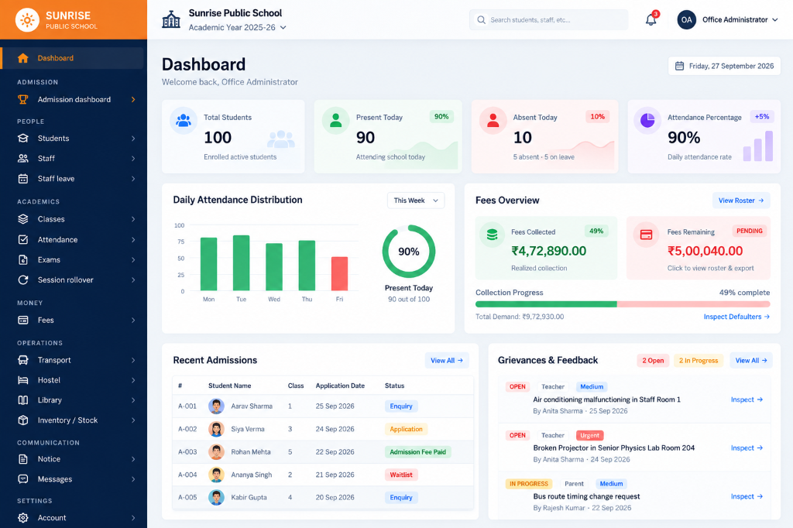

# SESSION-HANDOFF-25.md — Sunrise School ERP: Admin Dashboard UI Upgrade

**Date:** 02 October 2026  
**Status:** Completed Session 24 (Office Feedback Features & Holiday Multi-View Propagation Verified) -> Handoff to Session 25 (Admin Dashboard UI Upgrade)  
**Branch:** `slice/office-feedback`  
**Reference Design Image:** [`docs/design_references/admin_dashboard_upgrade_reference.png`](docs/design_references/admin_dashboard_upgrade_reference.png)

---

## 1. Visual Reference Image

Treat the above image strictly as visual inspiration for the **main dashboard content area**, NOT the sidebar or header.

---

## 2. Completed in Session 24

1. **FastAPI Route Shadowing Fix** (`backend/app/api/admin/applications.py`):
   - Moved static `@router.get("/applications/lookup")` above `@router.get("/applications/{application_id}")`.
2. **Library Borrower Fallbacks** (`backend/app/services/library.py` & `web/src/pages/Library.tsx`):
   - Supplied both canonical identifiers (`canonical_id`, `name`, `unpaid_fines_total`) and legacy aliases (`student_name`, `enrollment_code`, `unpaid_fines`).
3. **Holiday Editing & Multi-View Propagation (12/12 Passing Scenarios)**:
   - UI edit modal in `HolidayManagement.tsx` with date adjustment, multi-day ranges, and class section scoping.
   - Propagation verified across Admin Table, Web Attendance view (`/#/attendance`), Web Dashboard Upcoming Events (`/#/dashboard`), and Mobile Teacher Attendance API (`POST /teacher/attendance`).
4. **Clean Baseline**:
   - 800 backend pytest tests passed (1 skipped, 0 failed).
   - 134 web unit tests passed (2 skipped across 25 files).
   - 0 TypeScript errors on web (`npx tsc -b`) and mobile.
   - Clean Vite production build.

---

## 3. Session 25 Objective: Admin Dashboard UI Upgrade

Upgrade the existing **Sunrise School ERP Admin Dashboard** (`web/src/pages/Dashboard.tsx`) using the attached image as visual reference. Focus on improving visual quality, layout, typography, spacing, cards, and information hierarchy while preserving existing functionality and real data.

### Invariants & Non-Negotiable Rules:

1. **Strictly Preserve Existing Sidebar and Header Controls**:
   - **Do not modify the existing left sidebar or its design in any way** (`web/src/layout/Shell.tsx`).
   - Do not change its width, colors, branding, section headings, navigation items, icons, spacing, active states, or expand/collapse behavior.
   - Do not add, remove, or reposition either existing hamburger button.
   - Do not modify the existing top header layout or its functionality.
   - Do not add the search bar shown in the reference image.

2. **Dashboard Layout and Visual Design**:
   - Clean, modern SaaS/ERP appearance with light neutral background (`bg-ground`), crisp white content cards (`bg-surface`, `border border-rule`, `rounded-card`, `shadow-card`).
   - Improved typography, hierarchy, padding, and alignments.
   - Retain Sunrise orange and navy branding, using orange selectively for highlights/active accents, green for positive metrics, and red for negative/overdue metrics.
   - Responsive across desktop, laptop, and tablet.

3. **Attendance Overview Section**:
   - 4 prominent metric cards:
     - **Total Students** (with enrolled active students subtitle)
     - **Present Today** (with attending school count & positive status indicator)
     - **Absent Today** (with absent/on leave breakdown & negative/warning indicator)
     - **Attendance Percentage** (with daily attendance rate pill)
   - Retain and polish the daily attendance distribution/progress visualization where supported by current data (`data.attendance`).

4. **Fees Overview Section**:
   - Clear distinction between:
     - **Fees Collected** (with realized collection note & status badge)
     - **Fees Remaining** (with click to view roster note & pending badge)
     - **Collection Progress** (clean progress bar showing percentage)
     - **Total Demand** (formatted currency figure)
     - Functional links: **Inspect Defaulters** (opens modal) and **View Roster** (navigates to `/fees`).

5. **Grievances & Feedback Section**:
   - Display open, in-progress, and resolved counts clearly with summary pill badges.
   - Compact, readable list with title, category/role (`Teacher`, `Parent`), priority (`urgent`, `medium`, `low`), status, and submission date.
   - Retain functional **Inspect** action opening the existing grievance detail and reply modal.

6. **Dashboard Content Restrictions**:
   - **Do not add a Recent Admissions section or table.**
   - **Do not add the search bar shown in the reference.**
   - **Do not add new dashboard sections merely to imitate the reference image.**
   - **Do not remove existing functional dashboard sections**:
     - Retain **Upcoming Events** card (with exams and declared holidays, live query).
     - Retain **Recent Notices** card (with notice list and target audience).
     - Retain **Top Performers** card (with student attendance/performance rankings).
   - Preserve existing attendance, fees, grievances, and all other legitimate dashboard functionality.

7. **Data and Functionality Invariant**:
   - This is a UI upgrade, not a backend rewrite.
   - Use actual data from the existing APIs and database (`/admin/dashboard/stats`, `/admin/grievances`, `/admin/attendance/holidays`, `/admin/exams`, etc.).
   - Do not hardcode dashboard figures or create mock data.
   - Preserve existing API calls, calculations, routes, role-based access, and multi-tenant isolation.
   - Ensure all existing dashboard actions remain functional.
