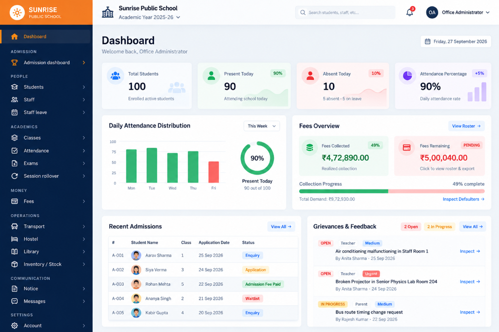

# SESSION 25 PROMPT — Sunrise School ERP: Admin Dashboard UI Upgrade

> **Instructions for User:** Copy and paste the entire block below into the chat when starting the next session.

---

```markdown
# MANDATORY WORKFLOW RULE — READ THIS FIRST BEFORE ANYTHING ELSE

IMPORTANT:
First generate a comprehensive, detailed implementation plan and present it to me.
When I review it and give approval, then only proceed with making changes or modifying code.
Do NOT start writing code, creating migrations, or modifying files until I have explicitly approved your implementation plan.

---

# Sunrise ERP — Admin Dashboard UI Upgrade

Upgrade the existing **Sunrise School ERP Admin Dashboard** (`web/src/pages/Dashboard.tsx`) using the visual reference image embedded below. Focus on improving the dashboard's visual quality, layout, typography, spacing, cards, charts, and information hierarchy while preserving all existing functionality and data.

## Visual Design Reference



> **Reference Image Path:** `docs/design_references/admin_dashboard_upgrade_reference.png`  
> Treat this image strictly as a visual inspiration for the **main dashboard content area**, NOT the sidebar or header.

---

## 1. Strictly Preserve the Existing Sidebar and Header Controls

**Do not modify the existing left sidebar or its design in any way.**
- Do not change its width, colors, branding, section headings, navigation items, icons, spacing, active states, or expand/collapse behavior (`web/src/layout/Shell.tsx`).
- Do not add, remove, or reposition either existing hamburger button.
- Do not modify the existing top header layout or its functionality.
- Do not add the search bar shown in the reference image.

Treat the attached image strictly as a reference for the **main dashboard content area**, not the sidebar or header.

---

## 2. Dashboard Layout and Visual Design

Redesign only the dashboard content area to achieve a clean, modern, professional SaaS/ERP appearance.

- Improve typography, spacing, alignment, and visual hierarchy.
- Use a light, neutral background with white content cards (`bg-surface`, subtle borders, rounded corners `rounded-card`).
- Use subtle borders (`border-rule`), soft shadows (`shadow-sm`, `shadow-card`), and consistent corner radii.
- Maintain the existing Sunrise orange and navy branding, using orange selectively for important actions and active elements.
- Use green for positive metrics, red for overdue/negative metrics, and neutral colors for supporting information.
- Make the dashboard responsive across desktop (1440px), laptop (1024px), and tablet screen sizes.
- Avoid excessive colors, decorative elements, and unnecessary card nesting.

---

## 3. Attendance Overview

Improve the existing Attendance Overview section with four clearly organized metric cards:

- **Total Students** (with enrolled active count description)
- **Present Today** (with attending school count & positive status pill)
- **Absent Today** (with absent & leave breakdown & warning status pill)
- **Attendance Percentage** (with daily attendance rate badge)

Make the numbers prominent, labels readable, and supporting descriptions smaller. Use restrained visual indicators and clear status colors.

Retain the existing daily attendance distribution/progress visualization where supported by the current implementation (`data.attendance`). Improve its presentation without introducing fake data.

---

## 4. Fees Overview

Redesign the existing Fees Overview section with a clear distinction between:

- **Fees Collected** (with realized collection description & green badge)
- **Fees Remaining** (with click to view roster & pending status badge)
- **Collection Progress** (clean progress bar showing collection percentage)
- **Total Demand** (formatted currency figure)
- **Inspect Defaulters / View Roster actions**, wherever these already exist

Make the collected and outstanding amounts easy to compare at a glance. Use a clean progress bar and appropriate status colors.

Preserve the existing fee calculations, links, permissions, and functionality (`showDefaultersModal`, navigation links).

---

## 5. Grievances & Feedback

Improve the existing Grievances & Feedback section:

- Display open, in-progress, and resolved counts clearly with pill badges (`2 Open`, `2 In Progress`, etc.).
- Present grievance items in a readable, compact list.
- Show relevant information such as title, category/submitter (`Teacher`, `Parent`), priority (`urgent`, `medium`, `low`), status, and date wherever currently available.
- Keep existing **Inspect / View** actions functional (including opening `selectedGrievance` modal and reply submission).
- Use clear status and priority indicators without making the section visually cluttered.

---

## 6. Dashboard Content Restrictions

- **Do not add a Recent Admissions section or table.**
- **Do not add the search bar shown in the reference.**
- **Do not add new dashboard sections merely to imitate the reference image.**
- **Do not remove existing functional dashboard sections** other than what is explicitly prohibited above:
  - Keep **Upcoming Events** card (with exams and declared holidays, live query).
  - Keep **Recent Notices** card (with notice list and target audience).
  - Keep **Top Performers** card (with student attendance/performance rankings).
- Preserve the existing attendance, fees, grievances, and other legitimate dashboard functionality.

---

## 7. Data and Functionality

This is a UI upgrade, not a backend rewrite.

- Use actual data from the existing APIs and database (`/admin/dashboard/stats`, `/admin/grievances`, `/admin/attendance/holidays`, `/admin/exams`, etc.).
- Do not hard-code dashboard figures or create mock data.
- Preserve existing API calls, calculations, routes, role-based access, and multi-tenant isolation.
- Do not introduce duplicate components or parallel data-fetching logic unnecessarily.
- Ensure all existing dashboard actions remain functional.

---

## 8. Implementation and Verification

First inspect the existing Admin Dashboard components, layout, styling, and data flow in `web/src/pages/Dashboard.tsx`. Reuse the current architecture and modify only what is necessary.

After implementation:
1. Verify the dashboard with real seeded data in the local development environment (`admin@sunrisepublic.edu` / `Admin@123`).
2. Check that all existing dashboard actions work (Defaulters modal, Grievance inspect & reply modal, links to Attendance register and fee roster).
3. Confirm the sidebar and both hamburger buttons remain completely unchanged.
4. Confirm no search bar or Recent Admissions section has been added.
5. Run the relevant web tests (`npm test`) and TypeScript checks (`npx tsc -b`).
6. Visually verify with screenshots saved to `docs/screenshots/` and report results.
```
