# The Sunrise ERP database

A reference for every table in `sunrise_test`: what it is for, every column it
has, and how it joins to the rest.

**117 tables, 1437 columns, 328 foreign keys.** Of those tables **82 hold data** in
the seeded demo school and **35 are empty** - not unfinished, simply features
this demo school has not exercised.

Columns, types, foreign keys and row counts below were **introspected from the
running database**, not written by hand, so they cannot have drifted from what
Postgres actually enforces. Each table's purpose is taken from the model's own
docstring where it has one.

> Generated against migration `a1b2c3d4e5f6` on branch `slice/office-feedback`.
> Row counts come from the seeded demo school and will differ on yours.

## How to read this schema

Five rules explain why the tables look the way they do. Without them the list
below is just nouns.

**1. Almost every table carries `school_id`.** This is a multi-tenant product
sold to separate, independent schools - a tenant is a customer, not a branch. The
column is declared on `TenantBase` so a new table cannot quietly be created
without one; a missing tenant key is a data leak between customers, not a style
problem. Three tables derive from `TimestampedBase` instead and have none, each
for a reason: `schools` *is* the tenant, and `permissions` and `scheduled_jobs`
are vocabulary belonging to the software rather than to any one school.
`alembic_version` is Alembic's own row and not part of the product at all.

**2. Year-scoped facts hang off `enrolment_id`; lifetime facts hang off
`student_id`.** A fee, an attendance mark, a bus seat and a set of marks all
belong to a child's *year in a class*, so they point at `enrolments`. A name, a
date of birth and an admission number belong to the child for life, so they
point at `students`. Getting this backwards silently carries last year's data
into the new class, which is the bug the enrolment split exists to prevent.

**3. Money is never edited.** An invoice is voided and reissued; a payment is
reversed by a contra entry - a second row with a negative amount and
`reverses_payment_id` pointing at the original. Nothing rewrites a figure in
place, so the history stays reconstructable.

**4. A balance is always a SUM, never a stored column.** Payments allocate to
*invoice lines* through `payment_allocations`, oldest first. What a family owes
is computed from those rows every time it is asked for.

**5. Destructive actions are audited with a reason.** `void`, `status_change`
and `delete` refuse to commit without one, and what is stored is the words the
person typed - never a string the software made up. `audit_log` is the only
record of why a notice was removed or a bus route suspended.

Two more conventions worth knowing: money is `numeric`, never a float, and
timestamps are `timestamptz`. Ids are `bigint` throughout.

One note on the diagrams below: because rule 1 means every single table
points at `schools`, those edges are omitted. Drawing 86 identical arrows
would bury the relationships that actually tell you something.

---

## Index

**Tenancy, identity and access** - `schools`, `academic_years`, `users`, `roles`, `permissions`, `role_permissions`, `user_roles`, `settings`, `custom_fields`, `number_sequences`, `alembic_version`

**People - students and guardians** - `students`, `guardians`, `student_guardian`, `enrolments` &middot; *empty:* `student_authorized_persons`

**People - staff** - `employees`, `departments`

**Academics** - `class_sections`, `subjects`, `class_subject_teacher`, `school_periods`, `timetable_slots`, `substitutions`, `holidays`, `homework`, `homework_submissions` &middot; *empty:* `holiday_class_sections`

**Attendance** - `attendance` &middot; *empty:* `student_leave_requests`

**Examinations and results** - `exams`, `exam_schedule`, `marks`, `assessment_schemes`, `scheme_components`, `grading_scales`, `grade_bands` &middot; *empty:* `report_card_publications`

**Fees and money** - `fee_heads`, `fee_plans`, `fee_plan_items`, `fee_concessions`, `fee_invoices`, `fee_invoice_lines`, `fee_payments`, `payment_allocations` &middot; *empty:* `student_fee_plans`, `fee_periods`

**Transport** - `vehicles`, `routes`, `route_stops`, `transport_assignments`, `transport_fee_slabs`

**HR and payroll** - `staff_attendance`, `staff_leave_requests`, `leave_types`, `salary_components`, `salary_structures` &middot; *empty:* `leave_balances`, `salary_structure_items`, `payroll_runs`, `payslips`, `payslip_lines`

**Admission** - `enquiries`, `admission_cycles`, `cycle_class_config`, `applications` &middot; *empty:* `enquiry_interactions`, `application_guardians`, `application_siblings`, `application_medical`, `application_payments`, `application_authorized_persons`, `application_document_overrides`, `assessments`, `assessment_subjects`, `interviews`, `admission_decisions`, `admission_offers`, `waitlist_entries`

**Library** - `books`, `book_copies`, `library_loans`

**Certificates** - `certificate_templates` &middot; *empty:* `student_certificates`

**Reception and front desk** - *empty:* `student_passes`, `principal_meeting_requests`, `found_items`, `directory_contacts`

**Teacher recruitment and hiring** - 

**Communication** - `notices`, `message_templates`, `in_app_notifications` &middot; *empty:* `messages`, `message_recipients`, `notification_preferences`, `alert_views`

**Inventory and stock** - `stock_items`, `stock_requests`

**Grievances and feedback** - `grievances`, `grievance_replies`

**Hostel and mess** - `hostels`, `hostel_floors`, `hostel_rooms`, `hostel_beds`, `hostel_admissions`, `bed_allocations`, `hostel_attendances`, `hostel_leave_requests`, `hostel_mess_menus`, `hostel_complaints`, `hostel_notices` &middot; *empty:* `hostel_incidents`

**System** - `audit_log`, `documents`, `document_types`, `scheduled_jobs` &middot; *empty:* `jobs`

---

# Part 1 - Tables in use (82)

Every table here holds data in the seeded school, and the row counts are live.

## Tenancy, identity and access

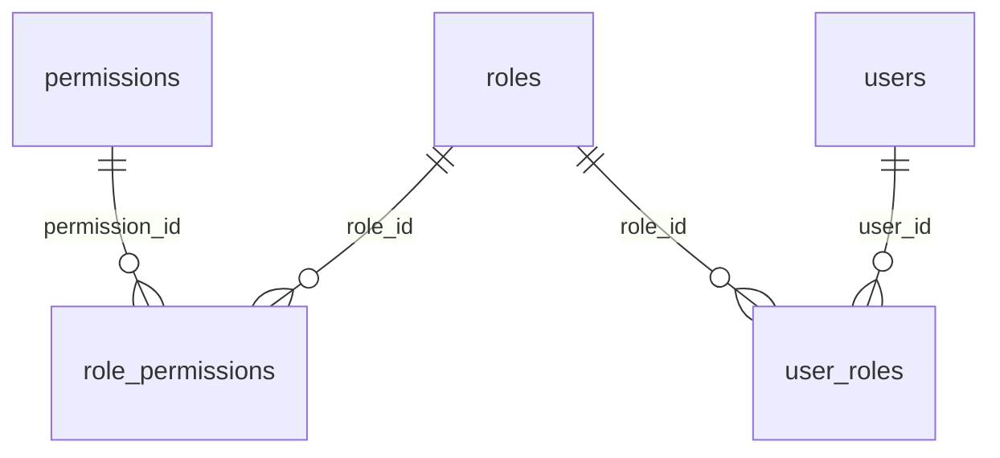

### `schools`

*1 rows / 17 columns*

One customer. The only table without a `school_id` of its own.

**Pointed at by:** `academic_years`, `admission_cycles`, `admission_decisions`, `admission_offers`, `alert_views`, `application_authorized_persons`, `application_document_overrides`, `application_guardians`, `application_medical`, `application_payments`, `application_siblings`, `applications`, `assessment_schemes`, `assessment_subjects`, `assessments`, `attendance`, `audit_log`, `bed_allocations`, `book_copies`, `books`, `certificate_templates`, `class_sections`, `class_subject_teacher`, `custom_fields`, `cycle_class_config`, `departments`, `directory_contacts`, `document_types`, `documents`, `employees`, `enquiries`, `enquiry_interactions`, `enrolments`, `exam_schedule`, `exams`, `fee_concessions`, `fee_heads`, `fee_invoice_lines`, `fee_invoices`, `fee_payments`, `fee_periods`, `fee_plan_items`, `fee_plans`, `found_items`, `grade_bands`, `grading_scales`, `grievance_replies`, `grievances`, `guardians`, `holiday_class_sections`, `holidays`, `homework`, `homework_submissions`, `hostel_admissions`, `hostel_attendances`, `hostel_beds`, `hostel_complaints`, `hostel_floors`, `hostel_incidents`, `hostel_leave_requests`, `hostel_mess_menus`, `hostel_notices`, `hostel_rooms`, `hostels`, `in_app_notifications`, `interviews`, `jobs`, `leave_balances`, `leave_types`, `library_loans`, `marks`, `message_recipients`, `message_templates`, `messages`, `notices`, `notification_preferences`, `number_sequences`, `payment_allocations`, `payroll_runs`, `payslip_lines`, `payslips`, `principal_meeting_requests`, `report_card_publications`, `role_permissions`, `roles`, `route_stops`, `routes`, `salary_components`, `salary_structure_items`, `salary_structures`, `scheme_components`, `school_periods`, `settings`, `staff_attendance`, `staff_leave_requests`, `stock_items`, `stock_requests`, `student_authorized_persons`, `student_certificates`, `student_fee_plans`, `student_guardian`, `student_leave_requests`, `student_passes`, `students`, `subjects`, `substitutions`, `timetable_slots`, `transport_assignments`, `transport_fee_slabs`, `user_roles`, `users`, `vehicles`, `waitlist_entries`

**Unique on:** `code`

| Column | Type | Null | Notes |
|---|---|---|---|
| `code` | varchar(16) | no | unique |
| `name` | varchar(160) | no | - |
| `status` | varchar(10) | no | - |
| `address` | text | yes | - |
| `city` | varchar(80) | yes | - |
| `state` | varchar(80) | yes | - |
| `pincode` | varchar(10) | yes | - |
| `phone` | varchar(20) | yes | - |
| `email` | varchar(160) | yes | - |
| `website` | varchar(200) | yes | - |
| `logo_url` | text | yes | - |
| `primary_color` | varchar(9) | yes | - |
| `board` | varchar(20) | yes | - |
| `affiliation_no` | varchar(40) | yes | - |
| `id` | bigint | no | primary key |
| `created_at` | timestamptz | no | default `now()` |
| `updated_at` | timestamptz | no | default `now()` |

### `academic_years`

*1 rows / 12 columns*

A session. Several may be open at once — 2026-27 active while 2027-28 takes
admissions and 2025-26 is closing is the normal state of a school in January,
which the v0 string could not express.

**Points at:** `schools`

**Pointed at by:** `admission_cycles`, `assessment_schemes`, `audit_log`, `class_sections`, `enrolments`, `fee_invoices`, `fee_plans`, `holidays`, `leave_balances`, `staff_leave_requests`

**Unique on:** `school_id,code`

| Column | Type | Null | Notes |
|---|---|---|---|
| `school_id` | bigint | no | -> `schools.id`, unique |
| `code` | varchar(9) | no | unique |
| `start_date` | date | no | - |
| `end_date` | date | no | - |
| `status` | varchar(15) | no | - |
| `is_current` | boolean | no | - |
| `promotion_completed_at` | date | yes | - |
| `result_published_at` | date | yes | - |
| `closed_at` | date | yes | - |
| `id` | bigint | no | primary key |
| `created_at` | timestamptz | no | default `now()` |
| `updated_at` | timestamptz | no | default `now()` |

### `users`

*230 rows / 14 columns*

Every person who can sign in - staff, students and guardians alike. One row per
login; the role-specific detail lives in `students`, `guardians` or `employees`,
each of which points back here.

**Points at:** `schools`

**Pointed at by:** `admission_decisions`, `alert_views`, `application_document_overrides`, `application_payments`, `applications`, `assessments`, `audit_log`, `bed_allocations`, `documents`, `employees`, `enquiries`, `enquiry_interactions`, `exam_schedule`, `fee_concessions`, `fee_payments`, `fee_periods`, `found_items`, `grievance_replies`, `grievances`, `guardians`, `holidays`, `hostel_admissions`, `hostel_attendances`, `hostel_complaints`, `hostel_incidents`, `hostel_leave_requests`, `hostel_mess_menus`, `hostel_notices`, `in_app_notifications`, `interviews`, `marks`, `message_recipients`, `messages`, `notices`, `notification_preferences`, `payroll_runs`, `principal_meeting_requests`, `report_card_publications`, `staff_attendance`, `staff_leave_requests`, `stock_items`, `stock_requests`, `student_certificates`, `student_fee_plans`, `student_leave_requests`, `student_passes`, `students`, `user_roles`

**Unique on:** `school_id,login_id`

| Column | Type | Null | Notes |
|---|---|---|---|
| `role` | varchar(7) | no | - |
| `login_id` | varchar(64) | no | unique |
| `password_hash` | varchar(255) | no | - |
| `full_name` | varchar(120) | no | - |
| `email` | varchar(160) | yes | - |
| `phone` | varchar(20) | yes | - |
| `photo_url` | text | yes | - |
| `is_active` | boolean | no | - |
| `app_access_blocked` | boolean | no | default `false` |
| `token_version` | integer | no | default `1` |
| `school_id` | bigint | no | -> `schools.id`, unique |
| `id` | bigint | no | primary key |
| `created_at` | timestamptz | no | default `now()` |
| `updated_at` | timestamptz | no | default `now()` |

### `roles`

*19 rows / 8 columns*

A named set of permissions. System roles ship with the product and cannot be
deleted; a school may copy one and adjust it.

**Points at:** `schools`

**Pointed at by:** `role_permissions`, `user_roles`

**Unique on:** `school_id,code`

| Column | Type | Null | Notes |
|---|---|---|---|
| `code` | varchar(40) | no | unique |
| `name` | varchar(80) | no | - |
| `description` | text | yes | - |
| `is_system` | boolean | no | - |
| `school_id` | bigint | no | -> `schools.id`, unique |
| `id` | bigint | no | primary key |
| `created_at` | timestamptz | no | default `now()` |
| `updated_at` | timestamptz | no | default `now()` |

### `permissions`

*129 rows / 7 columns*

A thing that can be done, named `module.resource.action`.

**Pointed at by:** `role_permissions`

**Unique on:** `code`

| Column | Type | Null | Notes |
|---|---|---|---|
| `code` | varchar(80) | no | unique |
| `module` | varchar(40) | no | - |
| `action` | varchar(40) | no | - |
| `description` | text | yes | - |
| `id` | bigint | no | primary key |
| `created_at` | timestamptz | no | default `now()` |
| `updated_at` | timestamptz | no | default `now()` |

### `role_permissions`

*515 rows / 6 columns*

Which permissions a role grants. Per school, so two tenants can define the same
role differently.

**Points at:** `permissions`, `roles`, `schools`

**Unique on:** `role_id,permission_id`

| Column | Type | Null | Notes |
|---|---|---|---|
| `role_id` | bigint | no | -> `roles.id`, unique |
| `permission_id` | bigint | no | -> `permissions.id`, unique |
| `school_id` | bigint | no | -> `schools.id` |
| `id` | bigint | no | primary key |
| `created_at` | timestamptz | no | default `now()` |
| `updated_at` | timestamptz | no | default `now()` |

### `user_roles`

*237 rows / 8 columns*

A user holds a role, optionally narrowed to part of the school.

**Points at:** `roles`, `schools`, `users`

**Unique on:** `user_id,role_id,scope_type,scope_id`

| Column | Type | Null | Notes |
|---|---|---|---|
| `user_id` | bigint | no | -> `users.id`, unique |
| `role_id` | bigint | no | -> `roles.id`, unique |
| `scope_type` | varchar(13) | no | unique |
| `scope_id` | bigint | yes | unique |
| `school_id` | bigint | no | -> `schools.id` |
| `id` | bigint | no | primary key |
| `created_at` | timestamptz | no | default `now()` |
| `updated_at` | timestamptz | no | default `now()` |

### `settings`

*5 rows / 6 columns*

Per-school configuration as key/value pairs, with the vocabulary defined in
`core/settings_registry.py`. Module switches live here too, as
`feature.<module>`.

**Points at:** `schools`

**Unique on:** `school_id,key`

| Column | Type | Null | Notes |
|---|---|---|---|
| `key` | varchar(80) | no | unique |
| `value` | json | no | - |
| `school_id` | bigint | no | -> `schools.id`, unique |
| `id` | bigint | no | primary key |
| `created_at` | timestamptz | no | default `now()` |
| `updated_at` | timestamptz | no | default `now()` |

### `custom_fields`

*2 rows / 12 columns*

One school-defined attribute on students, guardians, employees or applications
(§3.15 level 2).

**Points at:** `schools`

**Unique on:** `school_id,entity,key`

| Column | Type | Null | Notes |
|---|---|---|---|
| `entity` | varchar(11) | no | unique |
| `key` | varchar(40) | no | unique |
| `label` | varchar(120) | no | - |
| `field_type` | varchar(7) | no | - |
| `options` | json | yes | - |
| `is_required` | boolean | no | - |
| `is_active` | boolean | no | - |
| `sort_order` | integer | no | - |
| `school_id` | bigint | no | -> `schools.id`, unique |
| `id` | bigint | no | primary key |
| `created_at` | timestamptz | no | default `now()` |
| `updated_at` | timestamptz | no | default `now()` |

### `number_sequences`

*3 rows / 9 columns*

A gapless counter per school, per type, per year.

**Points at:** `schools`

**Unique on:** `school_id,kind,year`

| Column | Type | Null | Notes |
|---|---|---|---|
| `kind` | varchar(24) | no | unique |
| `year` | integer | no | unique |
| `prefix` | varchar(24) | yes | - |
| `width` | integer | no | - |
| `next_value` | integer | no | - |
| `school_id` | bigint | no | -> `schools.id`, unique |
| `id` | bigint | no | primary key |
| `created_at` | timestamptz | no | default `now()` |
| `updated_at` | timestamptz | no | default `now()` |

### `alembic_version`

*1 rows / 1 columns*

Alembic's own bookkeeping - the single row naming the migration this database is
at. Not part of the product; never edit it by hand.

_Stands alone: nothing references it and it references nothing._

| Column | Type | Null | Notes |
|---|---|---|---|
| `version_num` | varchar(32) | no | - |

## People - students and guardians

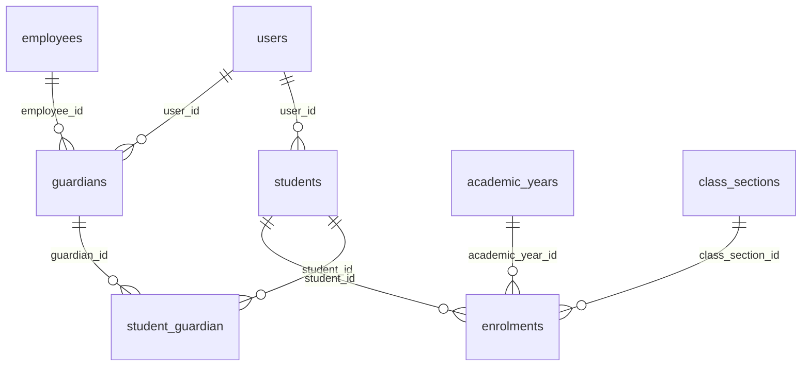

### `students`

*102 rows / 17 columns*

What is true about a student for life. Which class they sit in is a fact about a
*year* and lives on `enrolments` (ERP_BLUEPRINT §3.2).

**Points at:** `schools`, `users`

**Pointed at by:** `alert_views`, `application_siblings`, `applications`, `enrolments`, `found_items`, `grievances`, `hostel_admissions`, `hostel_attendances`, `hostel_complaints`, `hostel_incidents`, `hostel_leave_requests`, `message_recipients`, `student_authorized_persons`, `student_certificates`, `student_guardian`, `student_passes`

**Unique on:** `user_id`, `school_id,admission_no`

| Column | Type | Null | Notes |
|---|---|---|---|
| `user_id` | bigint | no | -> `users.id`, unique |
| `admission_no` | varchar(32) | no | unique |
| `status` | varchar(15) | no | - |
| `dob` | date | yes | - |
| `gender` | varchar(6) | yes | - |
| `address` | text | yes | - |
| `admission_date` | date | yes | - |
| `apaar_id` | varchar(12) | yes | - |
| `apaar_consent` | boolean | no | default `false` |
| `apaar_consent_guardian_name` | varchar(120) | yes | - |
| `apaar_consent_guardian_relation` | varchar(40) | yes | - |
| `apaar_consent_at` | timestamptz | yes | - |
| `custom` | json | no | - |
| `school_id` | bigint | no | -> `schools.id`, unique |
| `id` | bigint | no | primary key |
| `created_at` | timestamptz | no | default `now()` |
| `updated_at` | timestamptz | no | default `now()` |

### `guardians`

*98 rows / 7 columns*

Whoever is responsible for a child — not necessarily a parent (§3.4).

**Points at:** `employees`, `schools`, `users`

**Pointed at by:** `hostel_leave_requests`, `message_recipients`, `student_guardian`

**Unique on:** `user_id`

| Column | Type | Null | Notes |
|---|---|---|---|
| `user_id` | bigint | no | -> `users.id`, unique |
| `occupation` | varchar(80) | yes | - |
| `employee_id` | bigint | yes | -> `employees.id` |
| `school_id` | bigint | no | -> `schools.id` |
| `id` | bigint | no | primary key |
| `created_at` | timestamptz | no | default `now()` |
| `updated_at` | timestamptz | no | default `now()` |

### `student_guardian`

*100 rows / 8 columns*

The link, with the structure §3.4 asks for: which relation, and which one of
them the school actually rings.

**Points at:** `guardians`, `schools`, `students`

**Unique on:** `guardian_id,student_id`

| Column | Type | Null | Notes |
|---|---|---|---|
| `guardian_id` | bigint | no | -> `guardians.id`, unique |
| `student_id` | bigint | no | -> `students.id`, unique |
| `relation` | varchar(14) | no | - |
| `is_primary` | boolean | no | - |
| `school_id` | bigint | no | -> `schools.id` |
| `id` | bigint | no | primary key |
| `created_at` | timestamptz | no | default `now()` |
| `updated_at` | timestamptz | no | default `now()` |

### `enrolments`

*102 rows / 12 columns*

A student's membership of a section for one academic year. **The most important
join in the schema**: every year-scoped fact - fees, attendance, marks, a bus
seat - hangs off `enrolment_id`, never `student_id`.

**Points at:** `academic_years`, `class_sections`, `schools`, `students`

**Pointed at by:** `attendance`, `fee_concessions`, `fee_invoices`, `fee_payments`, `grievances`, `homework_submissions`, `library_loans`, `marks`, `report_card_publications`, `student_certificates`, `student_fee_plans`, `student_leave_requests`, `transport_assignments`

**Unique on:** `class_section_id,roll_no`

| Column | Type | Null | Notes |
|---|---|---|---|
| `student_id` | bigint | no | -> `students.id` |
| `academic_year_id` | bigint | no | -> `academic_years.id` |
| `class_section_id` | bigint | no | -> `class_sections.id`, unique |
| `roll_no` | integer | no | unique |
| `status` | varchar(15) | no | - |
| `joined_on` | date | yes | - |
| `left_on` | date | yes | - |
| `house` | varchar(20) | yes | - |
| `school_id` | bigint | no | -> `schools.id` |
| `id` | bigint | no | primary key |
| `created_at` | timestamptz | no | default `now()` |
| `updated_at` | timestamptz | no | default `now()` |

## People - staff

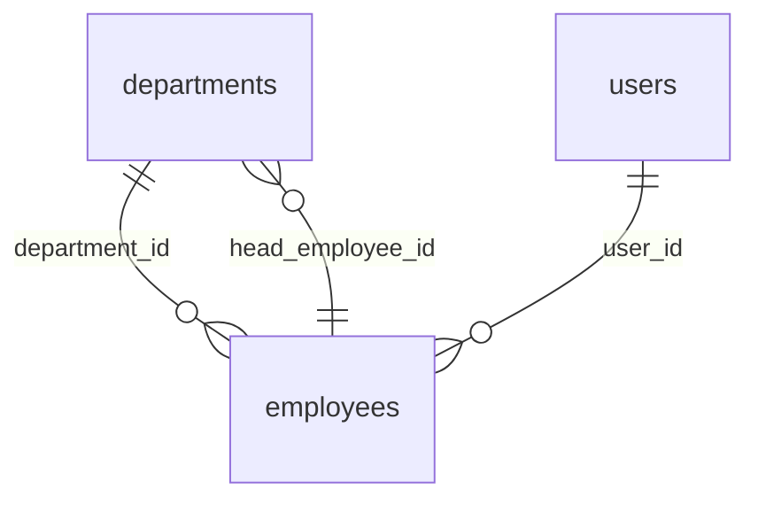

### `employees`

*16 rows / 22 columns*

Any member of staff, teaching or not (ERP_BLUEPRINT §3.4).

**Points at:** `departments`, `employees`, `schools`, `users`

**Pointed at by:** `application_guardians`, `attendance`, `class_sections`, `class_subject_teacher`, `departments`, `grievances`, `guardians`, `homework`, `leave_balances`, `library_loans`, `payslips`, `routes`, `salary_structures`, `staff_attendance`, `staff_leave_requests`, `substitutions`, `timetable_slots`

**Unique on:** `user_id`, `school_id,employee_code`

| Column | Type | Null | Notes |
|---|---|---|---|
| `user_id` | bigint | no | -> `users.id`, unique |
| `employee_code` | varchar(16) | no | unique |
| `employee_type` | varchar(14) | no | - |
| `qualification` | varchar(120) | yes | - |
| `joining_date` | date | yes | - |
| `department_id` | bigint | yes | -> `departments.id` |
| `designation` | varchar(60) | yes | - |
| `reporting_to_id` | bigint | yes | -> `employees.id` |
| `status` | varchar(13) | no | - |
| `exited_on` | date | yes | - |
| `emergency_contact_name` | varchar(120) | yes | - |
| `emergency_contact_phone` | varchar(20) | yes | - |
| `pan` | varchar(10) | yes | - |
| `uan` | varchar(12) | yes | - |
| `esi_number` | varchar(20) | yes | - |
| `bank_account_no` | varchar(20) | yes | - |
| `bank_ifsc` | varchar(11) | yes | - |
| `bank_name` | varchar(80) | yes | - |
| `school_id` | bigint | no | -> `schools.id`, unique |
| `id` | bigint | no | primary key |
| `created_at` | timestamptz | no | default `now()` |
| `updated_at` | timestamptz | no | default `now()` |

### `departments`

*6 rows / 7 columns*

A teaching or administrative department (§5.3.3).

**Points at:** `employees`, `schools`

**Pointed at by:** `employees`

**Unique on:** `school_id,code`

| Column | Type | Null | Notes |
|---|---|---|---|
| `code` | varchar(12) | no | unique |
| `name` | varchar(80) | no | - |
| `head_employee_id` | bigint | yes | -> `employees.id` |
| `school_id` | bigint | no | -> `schools.id`, unique |
| `id` | bigint | no | primary key |
| `created_at` | timestamptz | no | default `now()` |
| `updated_at` | timestamptz | no | default `now()` |

## Academics

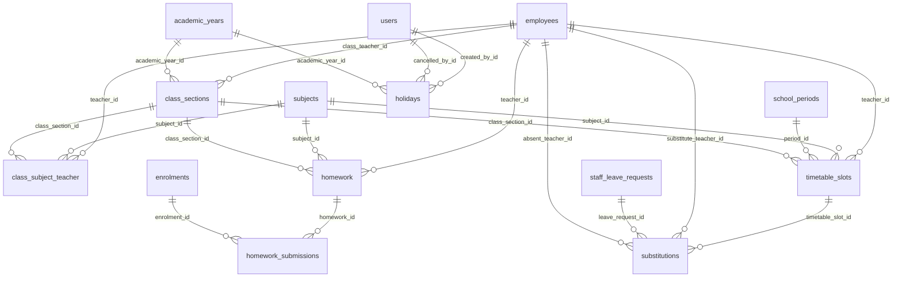

### `class_sections`

*10 rows / 11 columns*

One class-and-section for one academic year - 10-A, 9-B - with its capacity,
room and class teacher. The unit almost everything academic is scoped to.

**Points at:** `academic_years`, `employees`, `schools`

**Pointed at by:** `class_subject_teacher`, `enrolments`, `exam_schedule`, `holiday_class_sections`, `homework`, `notices`, `timetable_slots`

**Unique on:** `academic_year_id,class_name,section`

| Column | Type | Null | Notes |
|---|---|---|---|
| `class_name` | varchar(8) | no | unique |
| `section` | varchar(4) | no | unique |
| `class_teacher_id` | bigint | yes | -> `employees.id` |
| `academic_year_id` | bigint | no | -> `academic_years.id`, unique |
| `capacity` | integer | yes | - |
| `stream` | varchar(20) | yes | - |
| `room` | varchar(20) | yes | - |
| `school_id` | bigint | no | -> `schools.id` |
| `id` | bigint | no | primary key |
| `created_at` | timestamptz | no | default `now()` |
| `updated_at` | timestamptz | no | default `now()` |

### `subjects`

*9 rows / 6 columns*

The catalogue of subjects the school teaches. A subject exists once and is
attached to sections through `class_subject_teacher`.

**Points at:** `schools`

**Pointed at by:** `class_subject_teacher`, `exam_schedule`, `homework`, `timetable_slots`

**Unique on:** `school_id,code`

| Column | Type | Null | Notes |
|---|---|---|---|
| `name` | varchar(60) | no | - |
| `code` | varchar(12) | no | unique |
| `school_id` | bigint | no | -> `schools.id`, unique |
| `id` | bigint | no | primary key |
| `created_at` | timestamptz | no | default `now()` |
| `updated_at` | timestamptz | no | default `now()` |

### `class_subject_teacher`

*60 rows / 7 columns*

Which teacher teaches which subject to which section. The join that makes a
timetable solvable and decides whose marks entry is allowed.

**Points at:** `class_sections`, `employees`, `schools`, `subjects`

**Unique on:** `class_section_id,subject_id`

| Column | Type | Null | Notes |
|---|---|---|---|
| `class_section_id` | bigint | no | -> `class_sections.id`, unique |
| `subject_id` | bigint | no | -> `subjects.id`, unique |
| `teacher_id` | bigint | no | -> `employees.id` |
| `school_id` | bigint | no | -> `schools.id` |
| `id` | bigint | no | primary key |
| `created_at` | timestamptz | no | default `now()` |
| `updated_at` | timestamptz | no | default `now()` |

### `school_periods`

*6 rows / 9 columns*

Bell timings, once per school instead of once per slot.

**Points at:** `schools`

**Pointed at by:** `timetable_slots`

**Unique on:** `school_id,period_no`

| Column | Type | Null | Notes |
|---|---|---|---|
| `period_no` | integer | no | unique |
| `start_time` | time without time zone | no | - |
| `end_time` | time without time zone | no | - |
| `name` | varchar(20) | yes | - |
| `is_break` | boolean | no | - |
| `school_id` | bigint | no | -> `schools.id`, unique |
| `id` | bigint | no | primary key |
| `created_at` | timestamptz | no | default `now()` |
| `updated_at` | timestamptz | no | default `now()` |

### `timetable_slots`

*300 rows / 10 columns*

The weekly grid. Which subject, taught by which teacher, occupies which period
on which weekday for which section.

**Points at:** `class_sections`, `employees`, `school_periods`, `schools`, `subjects`

**Pointed at by:** `substitutions`

**Unique on:** `class_section_id,day_of_week,period_id`

| Column | Type | Null | Notes |
|---|---|---|---|
| `class_section_id` | bigint | no | -> `class_sections.id`, unique |
| `day_of_week` | varchar(3) | no | unique |
| `period_id` | bigint | no | -> `school_periods.id`, unique |
| `subject_id` | bigint | no | -> `subjects.id` |
| `teacher_id` | bigint | no | -> `employees.id` |
| `room` | varchar(20) | yes | - |
| `school_id` | bigint | no | -> `schools.id` |
| `id` | bigint | no | primary key |
| `created_at` | timestamptz | no | default `now()` |
| `updated_at` | timestamptz | no | default `now()` |

### `substitutions`

*1 rows / 11 columns*

One period, one day, covered by somebody else (§5.7.9).

**Points at:** `employees`, `schools`, `staff_leave_requests`, `timetable_slots`

**Unique on:** `timetable_slot_id,date`

| Column | Type | Null | Notes |
|---|---|---|---|
| `timetable_slot_id` | bigint | no | -> `timetable_slots.id`, unique |
| `date` | date | no | unique |
| `absent_teacher_id` | bigint | no | -> `employees.id` |
| `substitute_teacher_id` | bigint | yes | -> `employees.id` |
| `reason` | text | no | - |
| `status` | varchar(11) | no | - |
| `leave_request_id` | bigint | yes | -> `staff_leave_requests.id` |
| `school_id` | bigint | no | -> `schools.id` |
| `id` | bigint | no | primary key |
| `created_at` | timestamptz | no | default `now()` |
| `updated_at` | timestamptz | no | default `now()` |

### `holidays`

*5 rows / 15 columns*

A day or date-range the school or specific sections are shut.

**Points at:** `academic_years`, `schools`, `users`

**Pointed at by:** `holiday_class_sections`

| Column | Type | Null | Notes |
|---|---|---|---|
| `academic_year_id` | bigint | no | -> `academic_years.id` |
| `date` | date | no | - |
| `start_date` | date | no | - |
| `end_date` | date | no | - |
| `name` | varchar(120) | no | - |
| `description` | text | yes | - |
| `is_school_wide` | boolean | no | default `true` |
| `status` | varchar(20) | no | default `'active'` |
| `created_by_id` | bigint | yes | -> `users.id` |
| `cancelled_by_id` | bigint | yes | -> `users.id` |
| `cancellation_reason` | text | yes | - |
| `school_id` | bigint | no | -> `schools.id` |
| `id` | bigint | no | primary key |
| `created_at` | timestamptz | no | default `now()` |
| `updated_at` | timestamptz | no | default `now()` |

### `homework`

*8 rows / 12 columns*

A piece of homework set for a section and subject, with the date it is due.

**Points at:** `class_sections`, `employees`, `schools`, `subjects`

**Pointed at by:** `homework_submissions`

| Column | Type | Null | Notes |
|---|---|---|---|
| `class_section_id` | bigint | no | -> `class_sections.id` |
| `subject_id` | bigint | no | -> `subjects.id` |
| `teacher_id` | bigint | no | -> `employees.id` |
| `title` | varchar(160) | no | - |
| `description` | text | yes | - |
| `assigned_date` | date | no | - |
| `due_date` | date | no | - |
| `attachment_url` | varchar(500) | yes | - |
| `school_id` | bigint | no | -> `schools.id` |
| `id` | bigint | no | primary key |
| `created_at` | timestamptz | no | default `now()` |
| `updated_at` | timestamptz | no | default `now()` |

### `homework_submissions`

*47 rows / 12 columns*

A child's submission against one `homework` row, and whether it has been marked.

**Points at:** `enrolments`, `homework`, `schools`

**Unique on:** `homework_id,enrolment_id`

| Column | Type | Null | Notes |
|---|---|---|---|
| `homework_id` | bigint | no | -> `homework.id`, unique |
| `enrolment_id` | bigint | no | -> `enrolments.id`, unique |
| `answer_text` | text | no | - |
| `submitted_at` | timestamptz | no | - |
| `marks` | numeric(5,2) | yes | - |
| `remarks` | varchar(200) | yes | - |
| `graded_at` | timestamptz | yes | - |
| `attachment_url` | varchar(500) | yes | - |
| `school_id` | bigint | no | -> `schools.id` |
| `id` | bigint | no | primary key |
| `created_at` | timestamptz | no | default `now()` |
| `updated_at` | timestamptz | no | default `now()` |

## Attendance

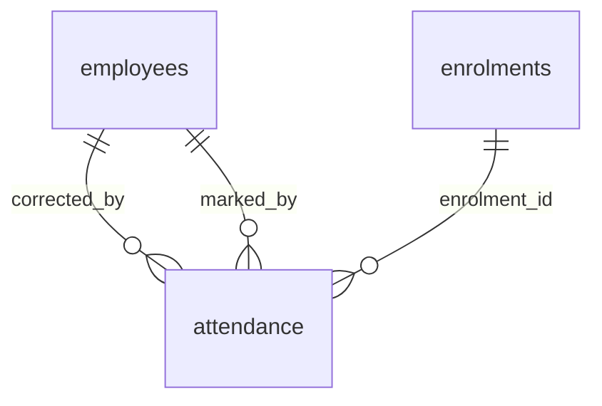

### `attendance`

*5,800 rows / 11 columns*

One day, one child, one mark.

**Points at:** `employees`, `enrolments`, `schools`

**Unique on:** `enrolment_id,date`

| Column | Type | Null | Notes |
|---|---|---|---|
| `enrolment_id` | bigint | no | -> `enrolments.id`, unique |
| `date` | date | no | unique |
| `status` | varchar(8) | no | - |
| `marked_by` | bigint | yes | -> `employees.id` |
| `remarks` | varchar(200) | yes | - |
| `corrected_by` | bigint | yes | -> `employees.id` |
| `corrected_at` | timestamptz | yes | - |
| `school_id` | bigint | no | -> `schools.id` |
| `id` | bigint | no | primary key |
| `created_at` | timestamptz | no | default `now()` |
| `updated_at` | timestamptz | no | default `now()` |

## Examinations and results

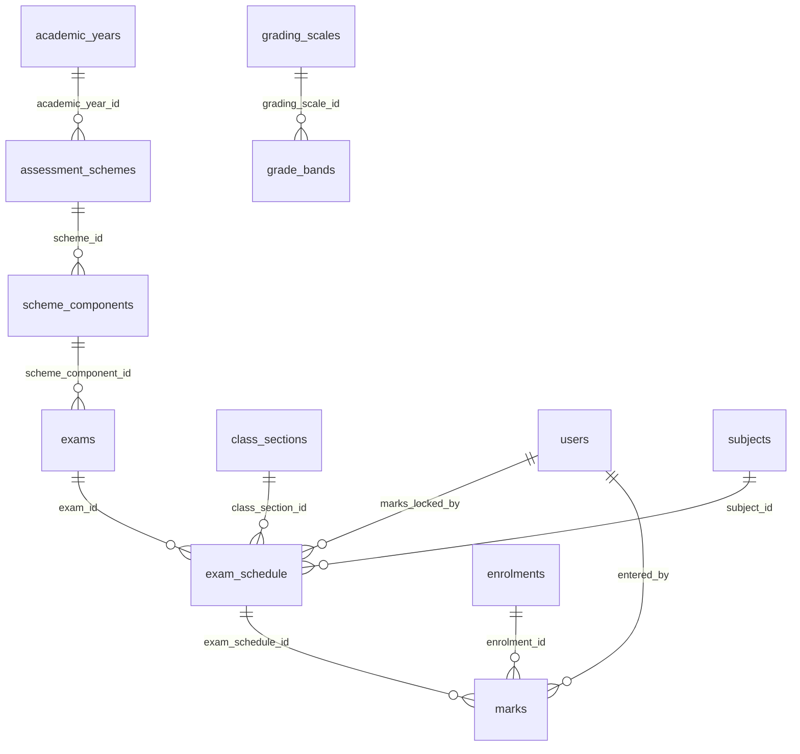

### `exams`

*4 rows / 9 columns*

One assessment event: "Term 1 Periodic Test", "Term 1 Examination".

**Points at:** `scheme_components`, `schools`

**Pointed at by:** `exam_schedule`

| Column | Type | Null | Notes |
|---|---|---|---|
| `name` | varchar(120) | no | - |
| `term` | varchar(20) | no | - |
| `start_date` | date | no | - |
| `end_date` | date | no | - |
| `scheme_component_id` | bigint | yes | -> `scheme_components.id` |
| `school_id` | bigint | no | -> `schools.id` |
| `id` | bigint | no | primary key |
| `created_at` | timestamptz | no | default `now()` |
| `updated_at` | timestamptz | no | default `now()` |

### `exam_schedule`

*240 rows / 13 columns*

One paper: this exam, this section, this subject.

**Points at:** `class_sections`, `exams`, `schools`, `subjects`, `users`

**Pointed at by:** `marks`

**Unique on:** `exam_id,class_section_id,subject_id`

| Column | Type | Null | Notes |
|---|---|---|---|
| `exam_id` | bigint | no | -> `exams.id`, unique |
| `class_section_id` | bigint | no | -> `class_sections.id`, unique |
| `subject_id` | bigint | no | -> `subjects.id`, unique |
| `exam_date` | date | no | - |
| `start_time` | time without time zone | yes | - |
| `max_marks` | numeric(5,2) | no | - |
| `room` | varchar(20) | yes | - |
| `marks_locked_at` | timestamptz | yes | - |
| `marks_locked_by` | bigint | yes | -> `users.id` |
| `school_id` | bigint | no | -> `schools.id` |
| `id` | bigint | no | primary key |
| `created_at` | timestamptz | no | default `now()` |
| `updated_at` | timestamptz | no | default `now()` |

### `marks`

*2,400 rows / 11 columns*

One child's result on one paper.

**Points at:** `enrolments`, `exam_schedule`, `schools`, `users`

**Unique on:** `exam_schedule_id,enrolment_id`

| Column | Type | Null | Notes |
|---|---|---|---|
| `exam_schedule_id` | bigint | no | -> `exam_schedule.id`, unique |
| `enrolment_id` | bigint | no | -> `enrolments.id`, unique |
| `marks_obtained` | numeric(5,2) | yes | - |
| `is_absent` | boolean | no | - |
| `is_exempted` | boolean | no | - |
| `remarks` | varchar(200) | yes | - |
| `entered_by` | bigint | no | -> `users.id` |
| `school_id` | bigint | no | -> `schools.id` |
| `id` | bigint | no | primary key |
| `created_at` | timestamptz | no | default `now()` |
| `updated_at` | timestamptz | no | default `now()` |

### `assessment_schemes`

*1 rows / 7 columns*

The shape of a year's assessment: its terms and what each is marked out of
(§5.4.3).

**Points at:** `academic_years`, `schools`

**Pointed at by:** `report_card_publications`, `scheme_components`

**Unique on:** `academic_year_id,name`

| Column | Type | Null | Notes |
|---|---|---|---|
| `academic_year_id` | bigint | no | -> `academic_years.id`, unique |
| `name` | varchar(80) | no | unique |
| `is_active` | boolean | no | - |
| `school_id` | bigint | no | -> `schools.id` |
| `id` | bigint | no | primary key |
| `created_at` | timestamptz | no | default `now()` |
| `updated_at` | timestamptz | no | default `now()` |

### `scheme_components`

*8 rows / 10 columns*

One markable column of the report card: "Term 1, Periodic Test, out of 10".

**Points at:** `assessment_schemes`, `schools`

**Pointed at by:** `exams`

**Unique on:** `scheme_id,term,code`

| Column | Type | Null | Notes |
|---|---|---|---|
| `scheme_id` | bigint | no | -> `assessment_schemes.id`, unique |
| `term` | varchar(20) | no | unique |
| `code` | varchar(12) | no | unique |
| `name` | varchar(60) | no | - |
| `max_marks` | numeric(5,2) | no | - |
| `sequence` | integer | no | - |
| `school_id` | bigint | no | -> `schools.id` |
| `id` | bigint | no | primary key |
| `created_at` | timestamptz | no | default `now()` |
| `updated_at` | timestamptz | no | default `now()` |

### `grading_scales`

*1 rows / 8 columns*

A named set of grade bands, versioned.

**Points at:** `schools`

**Pointed at by:** `grade_bands`, `report_card_publications`

**Unique on:** `school_id,name,version`

| Column | Type | Null | Notes |
|---|---|---|---|
| `name` | varchar(60) | no | unique |
| `version` | integer | no | unique |
| `is_active` | boolean | no | - |
| `frozen_at` | timestamptz | yes | - |
| `school_id` | bigint | no | -> `schools.id`, unique |
| `id` | bigint | no | primary key |
| `created_at` | timestamptz | no | default `now()` |
| `updated_at` | timestamptz | no | default `now()` |

### `grade_bands`

*8 rows / 8 columns*

One row of a grading scale: "91 and above is an A1".

**Points at:** `grading_scales`, `schools`

**Unique on:** `grading_scale_id,min_percent`, `grading_scale_id,grade`

| Column | Type | Null | Notes |
|---|---|---|---|
| `grading_scale_id` | bigint | no | -> `grading_scales.id`, unique |
| `min_percent` | numeric(5,2) | no | unique |
| `grade` | varchar(4) | no | unique |
| `description` | varchar(40) | yes | - |
| `school_id` | bigint | no | -> `schools.id` |
| `id` | bigint | no | primary key |
| `created_at` | timestamptz | no | default `now()` |
| `updated_at` | timestamptz | no | default `now()` |

## Fees and money

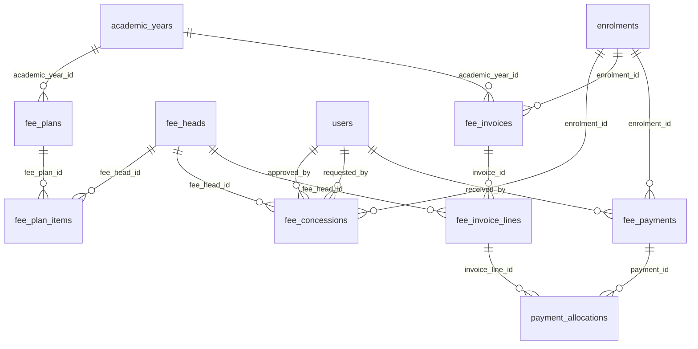

### `fee_heads`

*6 rows / 10 columns*

The named charges a school bills: tuition, transport, exam fee. The vocabulary
every invoice line is built from.

**Points at:** `schools`

**Pointed at by:** `fee_concessions`, `fee_invoice_lines`, `fee_plan_items`

**Unique on:** `school_id,code`

| Column | Type | Null | Notes |
|---|---|---|---|
| `name` | varchar(60) | no | - |
| `code` | varchar(16) | no | unique |
| `type` | varchar(9) | no | - |
| `is_refundable` | boolean | no | - |
| `gl_code` | varchar(20) | yes | - |
| `is_active` | boolean | no | - |
| `school_id` | bigint | no | -> `schools.id`, unique |
| `id` | bigint | no | primary key |
| `created_at` | timestamptz | no | default `now()` |
| `updated_at` | timestamptz | no | default `now()` |

### `fee_plans`

*11 rows / 8 columns*

What a class is charged for a year.

**Points at:** `academic_years`, `schools`

**Pointed at by:** `fee_plan_items`, `student_fee_plans`

**Unique on:** `academic_year_id,name`

| Column | Type | Null | Notes |
|---|---|---|---|
| `academic_year_id` | bigint | no | -> `academic_years.id`, unique |
| `name` | varchar(60) | no | unique |
| `class_name` | varchar(8) | yes | - |
| `is_active` | boolean | no | - |
| `school_id` | bigint | no | -> `schools.id` |
| `id` | bigint | no | primary key |
| `created_at` | timestamptz | no | default `now()` |
| `updated_at` | timestamptz | no | default `now()` |

### `fee_plan_items`

*31 rows / 8 columns*

The lines of a fee plan - which head, how much, how often. A plan means nothing
without these.

**Points at:** `fee_heads`, `fee_plans`, `schools`

**Unique on:** `fee_plan_id,fee_head_id`

| Column | Type | Null | Notes |
|---|---|---|---|
| `fee_plan_id` | bigint | no | -> `fee_plans.id`, unique |
| `fee_head_id` | bigint | no | -> `fee_heads.id`, unique |
| `amount` | numeric(10,2) | no | - |
| `frequency` | varchar(8) | no | - |
| `school_id` | bigint | no | -> `schools.id` |
| `id` | bigint | no | primary key |
| `created_at` | timestamptz | no | default `now()` |
| `updated_at` | timestamptz | no | default `now()` |

### `fee_concessions`

*2 rows / 16 columns*

A discount that someone approved.

**Points at:** `enrolments`, `fee_heads`, `schools`, `users`

| Column | Type | Null | Notes |
|---|---|---|---|
| `enrolment_id` | bigint | no | -> `enrolments.id` |
| `type` | varchar(11) | no | - |
| `fee_head_id` | bigint | yes | -> `fee_heads.id` |
| `percent` | numeric(5,2) | yes | - |
| `amount` | numeric(10,2) | yes | - |
| `reason` | text | no | - |
| `status` | varchar(9) | no | - |
| `requested_by` | bigint | yes | -> `users.id` |
| `approved_by` | bigint | yes | -> `users.id` |
| `decided_at` | timestamptz | yes | - |
| `valid_from` | date | yes | - |
| `valid_to` | date | yes | - |
| `school_id` | bigint | no | -> `schools.id` |
| `id` | bigint | no | primary key |
| `created_at` | timestamptz | no | default `now()` |
| `updated_at` | timestamptz | no | default `now()` |

### `fee_invoices`

*300 rows / 14 columns*

One month's bill for one enrolment (§0.6: monthly, per student).

**Points at:** `academic_years`, `enrolments`, `schools`

**Pointed at by:** `fee_invoice_lines`

**Unique on:** `school_id,invoice_no`

| Column | Type | Null | Notes |
|---|---|---|---|
| `enrolment_id` | bigint | no | -> `enrolments.id` |
| `academic_year_id` | bigint | no | -> `academic_years.id` |
| `invoice_no` | varchar(24) | no | unique |
| `period_month` | integer | no | - |
| `period_year` | integer | no | - |
| `issued_on` | date | no | - |
| `due_date` | date | no | - |
| `status` | varchar(14) | no | - |
| `settled_on` | date | yes | - |
| `void_reason` | text | yes | - |
| `school_id` | bigint | no | -> `schools.id`, unique |
| `id` | bigint | no | primary key |
| `created_at` | timestamptz | no | default `now()` |
| `updated_at` | timestamptz | no | default `now()` |

### `fee_invoice_lines`

*900 rows / 9 columns*

One head on one invoice. The unit a payment allocates against.

**Points at:** `fee_heads`, `fee_invoices`, `schools`

**Pointed at by:** `payment_allocations`

| Column | Type | Null | Notes |
|---|---|---|---|
| `invoice_id` | bigint | no | -> `fee_invoices.id` |
| `fee_head_id` | bigint | no | -> `fee_heads.id` |
| `description` | varchar(80) | no | - |
| `amount` | numeric(10,2) | no | - |
| `discount` | numeric(10,2) | no | - |
| `school_id` | bigint | no | -> `schools.id` |
| `id` | bigint | no | primary key |
| `created_at` | timestamptz | no | default `now()` |
| `updated_at` | timestamptz | no | default `now()` |

### `fee_payments`

*170 rows / 15 columns*

Money received. Against an enrolment, not against an invoice.

**Points at:** `enrolments`, `fee_payments`, `schools`, `users`

**Pointed at by:** `payment_allocations`

**Unique on:** `school_id,idempotency_key`, `school_id,receipt_no`

| Column | Type | Null | Notes |
|---|---|---|---|
| `enrolment_id` | bigint | no | -> `enrolments.id` |
| `receipt_no` | varchar(24) | no | unique |
| `amount` | numeric(10,2) | no | - |
| `method` | varchar(20) | no | - |
| `instrument_ref` | varchar(40) | yes | - |
| `received_at` | timestamptz | no | - |
| `received_by` | bigint | yes | -> `users.id` |
| `idempotency_key` | varchar(64) | no | unique |
| `status` | varchar(8) | no | - |
| `reverses_payment_id` | bigint | yes | -> `fee_payments.id` |
| `reason` | text | yes | - |
| `school_id` | bigint | no | -> `schools.id`, unique |
| `id` | bigint | no | primary key |
| `created_at` | timestamptz | no | default `now()` |
| `updated_at` | timestamptz | no | default `now()` |

### `payment_allocations`

*450 rows / 7 columns*

How much of a payment settled which line. The ledger's only truth about what is
paid — every balance in the system is a SUM over this table.

**Points at:** `fee_invoice_lines`, `fee_payments`, `schools`

| Column | Type | Null | Notes |
|---|---|---|---|
| `payment_id` | bigint | no | -> `fee_payments.id` |
| `invoice_line_id` | bigint | no | -> `fee_invoice_lines.id` |
| `amount` | numeric(10,2) | no | - |
| `school_id` | bigint | no | -> `schools.id` |
| `id` | bigint | no | primary key |
| `created_at` | timestamptz | no | default `now()` |
| `updated_at` | timestamptz | no | default `now()` |

## Transport

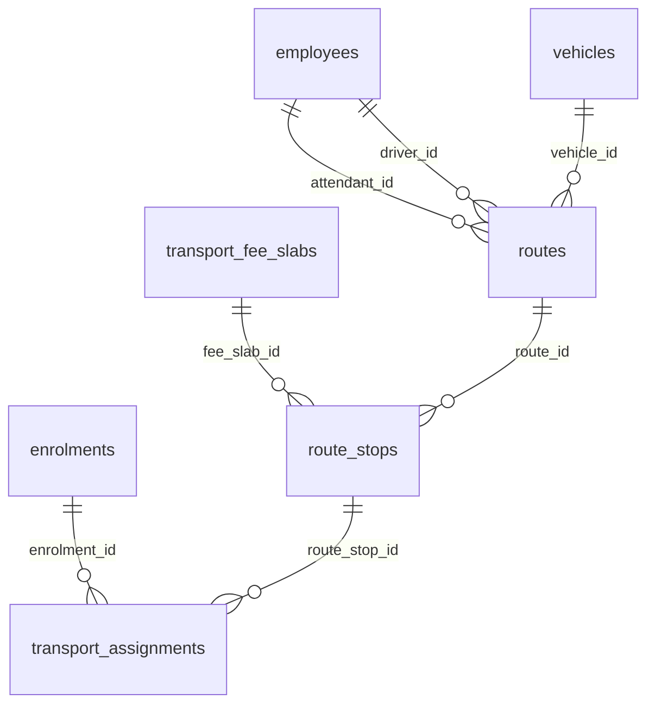

### `vehicles`

*2 rows / 10 columns*

A bus. `capacity` is the seating figure on the registration papers, and it is
the number the hard block in §5.6.9 counts against — not a soft target the
office can talk its way past.

**Points at:** `schools`

**Pointed at by:** `routes`

**Unique on:** `school_id,registration_no`

| Column | Type | Null | Notes |
|---|---|---|---|
| `registration_no` | varchar(20) | no | unique |
| `make_model` | varchar(60) | yes | - |
| `capacity` | integer | no | - |
| `ownership` | varchar(5) | no | - |
| `status` | varchar(17) | no | - |
| `gps_device_id` | varchar(40) | yes | - |
| `school_id` | bigint | no | -> `schools.id`, unique |
| `id` | bigint | no | primary key |
| `created_at` | timestamptz | no | default `now()` |
| `updated_at` | timestamptz | no | default `now()` |

### `routes`

*2 rows / 11 columns*

One bus doing one circuit.

**Points at:** `employees`, `schools`, `vehicles`

**Pointed at by:** `route_stops`

**Unique on:** `school_id,code`

| Column | Type | Null | Notes |
|---|---|---|---|
| `code` | varchar(16) | no | unique |
| `name` | varchar(80) | no | - |
| `vehicle_id` | bigint | yes | -> `vehicles.id` |
| `driver_id` | bigint | yes | -> `employees.id` |
| `attendant_id` | bigint | yes | -> `employees.id` |
| `distance_km` | numeric(6,2) | yes | - |
| `status` | varchar(9) | no | - |
| `school_id` | bigint | no | -> `schools.id`, unique |
| `id` | bigint | no | primary key |
| `created_at` | timestamptz | no | default `now()` |
| `updated_at` | timestamptz | no | default `now()` |

### `route_stops`

*7 rows / 14 columns*

A halt on a route, with the times the bus is actually there.

**Points at:** `routes`, `schools`, `transport_fee_slabs`

**Pointed at by:** `transport_assignments`

**Unique on:** `route_id,sequence`

| Column | Type | Null | Notes |
|---|---|---|---|
| `route_id` | bigint | no | -> `routes.id`, unique |
| `sequence` | integer | no | unique |
| `name` | varchar(80) | no | - |
| `address` | varchar(255) | yes | - |
| `landmark` | varchar(120) | yes | - |
| `pickup_time` | time without time zone | no | - |
| `drop_time` | time without time zone | yes | - |
| `fee_slab_id` | bigint | yes | -> `transport_fee_slabs.id` |
| `latitude` | float | yes | - |
| `longitude` | float | yes | - |
| `school_id` | bigint | no | -> `schools.id` |
| `id` | bigint | no | primary key |
| `created_at` | timestamptz | no | default `now()` |
| `updated_at` | timestamptz | no | default `now()` |

### `transport_assignments`

*30 rows / 11 columns*

A child on a bus, from a date until a date.

**Points at:** `enrolments`, `route_stops`, `schools`

| Column | Type | Null | Notes |
|---|---|---|---|
| `enrolment_id` | bigint | no | -> `enrolments.id` |
| `route_stop_id` | bigint | no | -> `route_stops.id` |
| `direction` | varchar(6) | no | - |
| `start_date` | date | no | - |
| `end_date` | date | yes | - |
| `status` | varchar(9) | no | - |
| `end_reason` | text | yes | - |
| `school_id` | bigint | no | -> `schools.id` |
| `id` | bigint | no | primary key |
| `created_at` | timestamptz | no | default `now()` |
| `updated_at` | timestamptz | no | default `now()` |

### `transport_fee_slabs`

*3 rows / 7 columns*

A distance band and its monthly price.

**Points at:** `schools`

**Pointed at by:** `route_stops`

**Unique on:** `school_id,name`

| Column | Type | Null | Notes |
|---|---|---|---|
| `name` | varchar(40) | no | unique |
| `monthly_amount` | numeric(10,2) | no | - |
| `is_active` | boolean | no | - |
| `school_id` | bigint | no | -> `schools.id`, unique |
| `id` | bigint | no | primary key |
| `created_at` | timestamptz | no | default `now()` |
| `updated_at` | timestamptz | no | default `now()` |

## HR and payroll

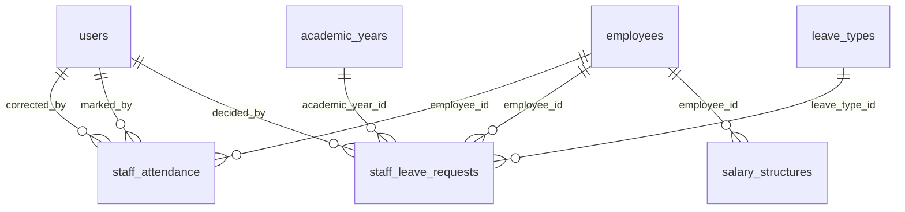

### `staff_attendance`

*1 rows / 12 columns*

One day, one member of staff, one mark.

**Points at:** `employees`, `schools`, `users`

**Unique on:** `employee_id,date`

| Column | Type | Null | Notes |
|---|---|---|---|
| `employee_id` | bigint | no | -> `employees.id`, unique |
| `date` | date | no | unique |
| `status` | varchar(8) | no | - |
| `check_in` | time without time zone | yes | - |
| `check_out` | time without time zone | yes | - |
| `marked_by` | bigint | yes | -> `users.id` |
| `corrected_by` | bigint | yes | -> `users.id` |
| `remarks` | varchar(200) | yes | - |
| `school_id` | bigint | no | -> `schools.id` |
| `id` | bigint | no | primary key |
| `created_at` | timestamptz | no | default `now()` |
| `updated_at` | timestamptz | no | default `now()` |

### `staff_leave_requests`

*1 rows / 17 columns*

One application, from draft to decision.

**Points at:** `academic_years`, `employees`, `leave_types`, `schools`, `users`

**Pointed at by:** `substitutions`

| Column | Type | Null | Notes |
|---|---|---|---|
| `employee_id` | bigint | no | -> `employees.id` |
| `leave_type_id` | bigint | yes | -> `leave_types.id` |
| `academic_year_id` | bigint | no | -> `academic_years.id` |
| `from_date` | date | no | - |
| `to_date` | date | no | - |
| `is_half_day` | boolean | no | - |
| `days` | numeric(5,1) | no | - |
| `reason` | text | no | - |
| `status` | varchar(9) | no | - |
| `balance_exception` | boolean | no | - |
| `decided_by` | bigint | yes | -> `users.id` |
| `decided_at` | timestamptz | yes | - |
| `decision_note` | text | yes | - |
| `school_id` | bigint | no | -> `schools.id` |
| `id` | bigint | no | primary key |
| `created_at` | timestamptz | no | default `now()` |
| `updated_at` | timestamptz | no | default `now()` |

### `leave_types`

*4 rows / 9 columns*

One kind of staff leave, with its yearly entitlement.

**Points at:** `schools`

**Pointed at by:** `leave_balances`, `staff_leave_requests`

**Unique on:** `school_id,code`

| Column | Type | Null | Notes |
|---|---|---|---|
| `code` | varchar(12) | no | unique |
| `name` | varchar(60) | no | - |
| `annual_quota` | numeric(5,1) | no | - |
| `is_paid` | boolean | no | - |
| `active` | boolean | no | - |
| `school_id` | bigint | no | -> `schools.id`, unique |
| `id` | bigint | no | primary key |
| `created_at` | timestamptz | no | default `now()` |
| `updated_at` | timestamptz | no | default `now()` |

### `salary_components`

*11 rows / 14 columns*

One line a payslip can carry, and how its amount is worked out.

**Points at:** `schools`

**Pointed at by:** `payslip_lines`, `salary_structure_items`

**Unique on:** `school_id,code`

| Column | Type | Null | Notes |
|---|---|---|---|
| `code` | varchar(16) | no | unique |
| `name` | varchar(60) | no | - |
| `type` | varchar(21) | no | - |
| `calculation` | varchar(16) | no | - |
| `value` | numeric(12,2) | no | - |
| `applies_below_gross` | numeric(12,2) | yes | - |
| `taxable` | boolean | no | - |
| `statutory` | boolean | no | - |
| `active` | boolean | no | - |
| `sequence` | integer | no | - |
| `school_id` | bigint | no | -> `schools.id`, unique |
| `id` | bigint | no | primary key |
| `created_at` | timestamptz | no | default `now()` |
| `updated_at` | timestamptz | no | default `now()` |

### `salary_structures`

*16 rows / 9 columns*

What one employee is on, from a date.

**Points at:** `employees`, `schools`

**Pointed at by:** `salary_structure_items`

**Unique on:** `employee_id,effective_from`

| Column | Type | Null | Notes |
|---|---|---|---|
| `employee_id` | bigint | no | -> `employees.id`, unique |
| `effective_from` | date | no | unique |
| `monthly_gross` | numeric(12,2) | no | - |
| `is_active` | boolean | no | - |
| `note` | text | yes | - |
| `school_id` | bigint | no | -> `schools.id` |
| `id` | bigint | no | primary key |
| `created_at` | timestamptz | no | default `now()` |
| `updated_at` | timestamptz | no | default `now()` |

## Admission

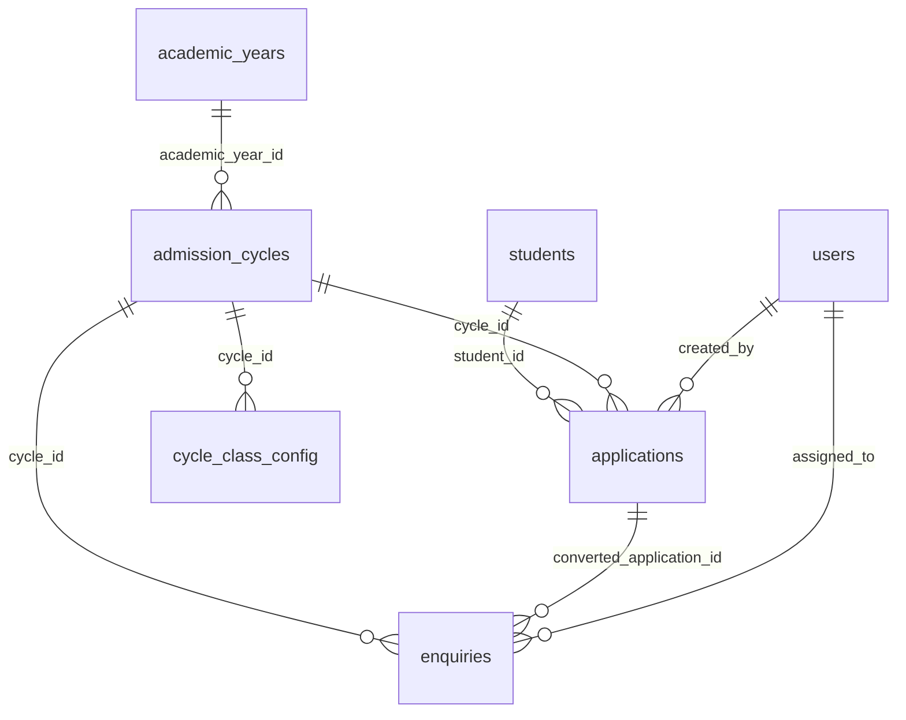

### `enquiries`

*6 rows / 16 columns*

A prospective parent's enquiry, before any application exists. The top of the
admission funnel.

**Points at:** `admission_cycles`, `applications`, `schools`, `users`

**Pointed at by:** `enquiry_interactions`

| Column | Type | Null | Notes |
|---|---|---|---|
| `cycle_id` | bigint | no | -> `admission_cycles.id` |
| `enquirer_name` | varchar(120) | no | - |
| `mobile` | varchar(20) | no | - |
| `email` | varchar(160) | yes | - |
| `child_name` | varchar(120) | yes | - |
| `child_dob` | date | yes | - |
| `class_of_interest` | varchar(8) | yes | - |
| `source` | varchar(10) | no | - |
| `status` | varchar(23) | no | - |
| `assigned_to` | bigint | yes | -> `users.id` |
| `next_follow_up_on` | date | yes | - |
| `converted_application_id` | bigint | yes | -> `applications.id` |
| `school_id` | bigint | no | -> `schools.id` |
| `id` | bigint | no | primary key |
| `created_at` | timestamptz | no | default `now()` |
| `updated_at` | timestamptz | no | default `now()` |

### `admission_cycles`

*1 rows / 13 columns*

One intake season for one academic year.

**Points at:** `academic_years`, `schools`

**Pointed at by:** `applications`, `cycle_class_config`, `enquiries`, `waitlist_entries`

**Unique on:** `school_id,academic_year_id,name`

| Column | Type | Null | Notes |
|---|---|---|---|
| `academic_year_id` | bigint | no | -> `academic_years.id`, unique |
| `name` | varchar(80) | no | unique |
| `status` | varchar(8) | no | - |
| `starts_on` | date | yes | - |
| `ends_on` | date | yes | - |
| `application_fee` | numeric(10,2) | no | - |
| `late_fee` | numeric(10,2) | no | - |
| `allow_online_applications` | boolean | no | - |
| `admission_fee_refund_policy` | text | yes | - |
| `school_id` | bigint | no | -> `schools.id`, unique |
| `id` | bigint | no | primary key |
| `created_at` | timestamptz | no | default `now()` |
| `updated_at` | timestamptz | no | default `now()` |

### `cycle_class_config`

*3 rows / 15 columns*

Seats and rules for one class within one cycle.

**Points at:** `admission_cycles`, `schools`

**Unique on:** `cycle_id,class_name,stream`

| Column | Type | Null | Notes |
|---|---|---|---|
| `cycle_id` | bigint | no | -> `admission_cycles.id`, unique |
| `class_name` | varchar(8) | no | unique |
| `stream` | varchar(20) | yes | unique |
| `total_seats` | integer | no | - |
| `reserved_seats` | json | yes | - |
| `age_on` | date | yes | - |
| `min_age_years` | numeric(4,2) | yes | - |
| `max_age_years` | numeric(4,2) | yes | - |
| `requires_test` | boolean | no | - |
| `requires_interview` | boolean | no | - |
| `required_document_codes` | json | yes | - |
| `school_id` | bigint | no | -> `schools.id` |
| `id` | bigint | no | primary key |
| `created_at` | timestamptz | no | default `now()` |
| `updated_at` | timestamptz | no | default `now()` |

### `applications`

*1 rows / 45 columns*

One child's candidacy in one cycle.

**Points at:** `admission_cycles`, `applications`, `schools`, `students`, `users`

**Pointed at by:** `admission_decisions`, `admission_offers`, `application_authorized_persons`, `application_document_overrides`, `application_guardians`, `application_medical`, `application_payments`, `application_siblings`, `assessments`, `enquiries`, `interviews`, `message_recipients`, `waitlist_entries`

**Unique on:** `school_id,application_no`

| Column | Type | Null | Notes |
|---|---|---|---|
| `cycle_id` | bigint | no | -> `admission_cycles.id` |
| `application_no` | varchar(24) | yes | unique |
| `first_name` | varchar(60) | no | - |
| `middle_name` | varchar(60) | yes | - |
| `last_name` | varchar(60) | no | - |
| `date_of_birth` | date | no | - |
| `gender` | varchar(12) | no | - |
| `nationality` | varchar(40) | yes | - |
| `religion` | varchar(40) | yes | - |
| `caste_category` | varchar(12) | yes | - |
| `mother_tongue` | varchar(40) | yes | - |
| `place_of_birth` | varchar(80) | yes | - |
| `identification_marks` | text | yes | - |
| `is_single_child` | boolean | no | - |
| `aadhaar_last4` | varchar(4) | yes | - |
| `aadhaar_verified` | boolean | no | - |
| `apaar_id` | varchar(12) | yes | - |
| `apaar_consent` | boolean | no | default `false` |
| `apaar_consent_guardian_name` | varchar(120) | yes | - |
| `apaar_consent_guardian_relation` | varchar(40) | yes | - |
| `apaar_consent_at` | timestamptz | yes | - |
| `class_applying_for` | varchar(8) | no | - |
| `stream` | varchar(20) | yes | - |
| `second_language` | varchar(40) | yes | - |
| `optional_subject` | varchar(40) | yes | - |
| `preferred_section` | varchar(4) | yes | - |
| `admission_category` | varchar(12) | no | - |
| `transport_required` | boolean | no | - |
| `hostel_required` | boolean | no | default `false` |
| `status` | varchar(27) | no | - |
| `submitted_at` | timestamptz | yes | - |
| `source` | varchar(10) | no | - |
| `created_by` | bigint | yes | -> `users.id` |
| `address` | json | yes | - |
| `previous_school` | json | yes | - |
| `declarations` | json | yes | - |
| `sibling_verified` | boolean | no | - |
| `staff_ward_verified` | boolean | no | - |
| `age_override_reason` | text | yes | - |
| `previous_application_id` | bigint | yes | -> `applications.id` |
| `student_id` | bigint | yes | -> `students.id` |
| `school_id` | bigint | no | -> `schools.id`, unique |
| `id` | bigint | no | primary key |
| `created_at` | timestamptz | no | default `now()` |
| `updated_at` | timestamptz | no | default `now()` |

## Library

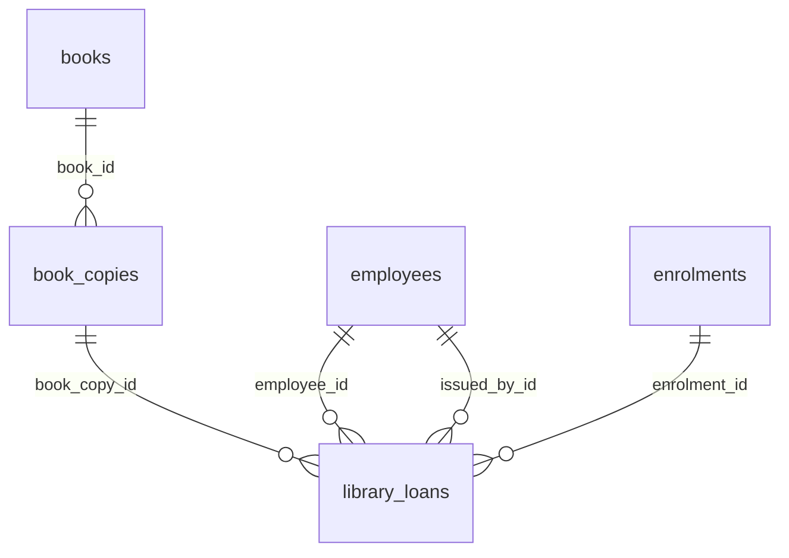

### `books`

*6 rows / 12 columns*

A book title in the library catalog.

**Points at:** `schools`

**Pointed at by:** `book_copies`

| Column | Type | Null | Notes |
|---|---|---|---|
| `isbn` | varchar(20) | yes | - |
| `title` | varchar(200) | no | - |
| `author` | varchar(120) | no | - |
| `publisher` | varchar(120) | yes | - |
| `category` | varchar(60) | no | - |
| `total_copies` | integer | no | - |
| `available_copies` | integer | no | - |
| `shelf_location` | varchar(40) | yes | - |
| `school_id` | bigint | no | -> `schools.id` |
| `id` | bigint | no | primary key |
| `created_at` | timestamptz | no | default `now()` |
| `updated_at` | timestamptz | no | default `now()` |

### `book_copies`

*14 rows / 8 columns*

An individual physical copy of a book, identified by a unique accession number.

**Points at:** `books`, `schools`

**Pointed at by:** `library_loans`

**Unique on:** `school_id,accession_no`

| Column | Type | Null | Notes |
|---|---|---|---|
| `book_id` | bigint | no | -> `books.id` |
| `accession_no` | varchar(40) | no | unique |
| `barcode` | varchar(60) | yes | - |
| `status` | varchar(20) | no | - |
| `school_id` | bigint | no | -> `schools.id`, unique |
| `id` | bigint | no | primary key |
| `created_at` | timestamptz | no | default `now()` |
| `updated_at` | timestamptz | no | default `now()` |

### `library_loans`

*2 rows / 16 columns*

A circulation record: book copy issued to an enrolled student (via Enrollment
ID) or a staff member.

**Points at:** `book_copies`, `employees`, `enrolments`, `schools`

| Column | Type | Null | Notes |
|---|---|---|---|
| `book_copy_id` | bigint | no | -> `book_copies.id` |
| `enrolment_id` | bigint | yes | -> `enrolments.id` |
| `employee_id` | bigint | yes | -> `employees.id` |
| `issued_by_id` | bigint | no | -> `employees.id` |
| `issued_on` | date | no | - |
| `due_date` | date | no | - |
| `returned_on` | date | yes | - |
| `status` | varchar(20) | no | - |
| `fine_amount` | numeric(10,2) | no | - |
| `fine_paid` | boolean | no | - |
| `renewal_count` | integer | no | - |
| `remarks` | text | yes | - |
| `school_id` | bigint | no | -> `schools.id` |
| `id` | bigint | no | primary key |
| `created_at` | timestamptz | no | default `now()` |
| `updated_at` | timestamptz | no | default `now()` |

## Certificates

### `certificate_templates`

*3 rows / 11 columns*

Configurable certificate template for a school. Allows institutional details,
signatory titles, and wording to be configured rather than hardcoded.

**Points at:** `schools`

**Unique on:** `school_id,certificate_type`

| Column | Type | Null | Notes |
|---|---|---|---|
| `certificate_type` | varchar(30) | no | unique |
| `title` | varchar(120) | no | - |
| `header_text` | text | yes | - |
| `body_template` | text | no | - |
| `signatory_name` | varchar(120) | yes | - |
| `signatory_title` | varchar(80) | yes | - |
| `show_seal` | boolean | no | default `true` |
| `school_id` | bigint | no | -> `schools.id`, unique |
| `id` | bigint | no | primary key |
| `created_at` | timestamptz | no | default `now()` |
| `updated_at` | timestamptz | no | default `now()` |

## Communication

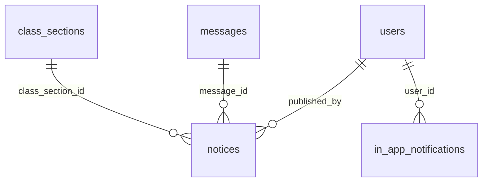

### `notices`

*6 rows / 17 columns*

The noticeboard. An announcement with an audience - the whole school, one class,
parents, teachers - optionally also sent as a message.

**Points at:** `class_sections`, `messages`, `schools`, `users`

| Column | Type | Null | Notes |
|---|---|---|---|
| `title` | varchar(160) | no | - |
| `body` | text | no | - |
| `audience` | varchar(8) | no | - |
| `class_section_id` | bigint | yes | -> `class_sections.id` |
| `published_by` | bigint | no | -> `users.id` |
| `published_at` | timestamptz | no | - |
| `message_id` | bigint | yes | -> `messages.id` |
| `category` | varchar(50) | no | - |
| `is_public` | boolean | no | - |
| `is_pinned` | boolean | no | - |
| `summary` | varchar(300) | yes | - |
| `expiry_date` | date | yes | - |
| `attachment_url` | varchar(255) | yes | - |
| `school_id` | bigint | no | -> `schools.id` |
| `id` | bigint | no | primary key |
| `created_at` | timestamptz | no | default `now()` |
| `updated_at` | timestamptz | no | default `now()` |

### `message_templates`

*4 rows / 12 columns*

Versioned, so the exact text sent stays reproducible (§5.9.9).

**Points at:** `schools`

**Pointed at by:** `messages`

**Unique on:** `school_id,code,version`

| Column | Type | Null | Notes |
|---|---|---|---|
| `code` | varchar(40) | no | unique |
| `version` | integer | no | unique |
| `name` | varchar(80) | no | - |
| `channel` | varchar(8) | no | - |
| `category` | varchar(11) | no | - |
| `subject` | varchar(200) | no | - |
| `body` | text | no | - |
| `is_active` | boolean | no | - |
| `school_id` | bigint | no | -> `schools.id`, unique |
| `id` | bigint | no | primary key |
| `created_at` | timestamptz | no | default `now()` |
| `updated_at` | timestamptz | no | default `now()` |

### `in_app_notifications`

*1 rows / 10 columns*

In-app alert for staff, teachers, or admins regarding leaves, substitutions,
etc.

**Points at:** `schools`, `users`

| Column | Type | Null | Notes |
|---|---|---|---|
| `user_id` | bigint | no | -> `users.id` |
| `title` | varchar(150) | no | - |
| `message` | text | no | - |
| `category` | varchar(50) | no | - |
| `link_url` | varchar(255) | yes | - |
| `is_read` | boolean | no | - |
| `school_id` | bigint | no | -> `schools.id` |
| `id` | bigint | no | primary key |
| `created_at` | timestamptz | no | default `now()` |
| `updated_at` | timestamptz | no | default `now()` |

## Inventory and stock

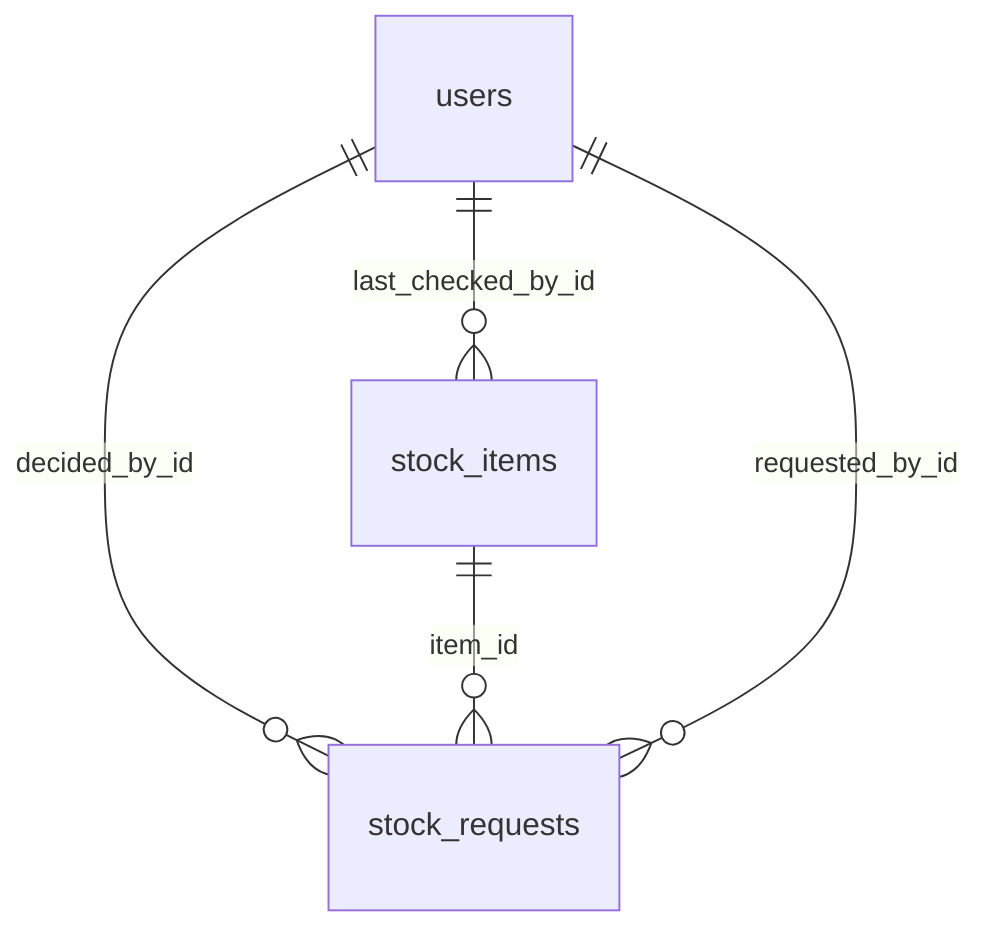

### `stock_items`

*31 rows / 16 columns*

An inventory item held in a school store, lab, or room.

**Points at:** `schools`, `users`

**Pointed at by:** `stock_requests`

| Column | Type | Null | Notes |
|---|---|---|---|
| `name` | varchar(120) | no | - |
| `category` | varchar(60) | no | - |
| `location` | varchar(80) | no | - |
| `unit` | varchar(30) | no | - |
| `current_quantity` | integer | no | - |
| `min_quantity` | integer | no | - |
| `unit_cost` | numeric(10,2) | yes | - |
| `is_critical` | boolean | no | - |
| `has_discrepancy` | boolean | no | - |
| `discrepancy_notes` | text | yes | - |
| `last_checked_at` | timestamptz | yes | - |
| `last_checked_by_id` | bigint | yes | -> `users.id` |
| `school_id` | bigint | no | -> `schools.id` |
| `id` | bigint | no | primary key |
| `created_at` | timestamptz | no | default `now()` |
| `updated_at` | timestamptz | no | default `now()` |

### `stock_requests`

*9 rows / 18 columns*

A stock replenishment request, purchase indent, or teacher diminishing-stock
flag.

**Points at:** `schools`, `stock_items`, `users`

| Column | Type | Null | Notes |
|---|---|---|---|
| `item_id` | bigint | yes | -> `stock_items.id` |
| `item_name` | varchar(120) | no | - |
| `category` | varchar(60) | no | - |
| `location` | varchar(80) | no | - |
| `quantity_requested` | integer | no | - |
| `urgency` | varchar(20) | no | - |
| `status` | varchar(20) | no | - |
| `flag_type` | varchar(20) | no | - |
| `requested_by_id` | bigint | no | -> `users.id` |
| `requested_by_name` | varchar(120) | no | - |
| `reason` | text | no | - |
| `decided_by_id` | bigint | yes | -> `users.id` |
| `decided_at` | timestamptz | yes | - |
| `decision_note` | text | yes | - |
| `school_id` | bigint | no | -> `schools.id` |
| `id` | bigint | no | primary key |
| `created_at` | timestamptz | no | default `now()` |
| `updated_at` | timestamptz | no | default `now()` |

## Grievances and feedback

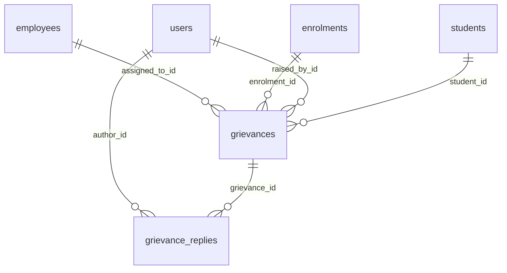

### `grievances`

*5 rows / 19 columns*

A formal grievance or issue raised by a teacher, parent, or student.

**Points at:** `employees`, `enrolments`, `schools`, `students`, `users`

**Pointed at by:** `grievance_replies`

| Column | Type | Null | Notes |
|---|---|---|---|
| `title` | varchar(200) | no | - |
| `description` | text | no | - |
| `category` | varchar(60) | no | - |
| `raised_by_id` | bigint | no | -> `users.id` |
| `raised_by_role` | varchar(30) | no | - |
| `raised_by_name` | varchar(120) | no | - |
| `student_id` | bigint | yes | -> `students.id` |
| `student_name` | varchar(120) | yes | - |
| `enrolment_id` | bigint | yes | -> `enrolments.id` |
| `status` | varchar(30) | no | - |
| `priority` | varchar(20) | no | - |
| `assigned_to_id` | bigint | yes | -> `employees.id` |
| `assigned_to_name` | varchar(120) | yes | - |
| `resolution_notes` | text | yes | - |
| `resolved_at` | timestamptz | yes | - |
| `school_id` | bigint | no | -> `schools.id` |
| `id` | bigint | no | primary key |
| `created_at` | timestamptz | no | default `now()` |
| `updated_at` | timestamptz | no | default `now()` |

### `grievance_replies`

*4 rows / 10 columns*

A response or progress note on a grievance thread.

**Points at:** `grievances`, `schools`, `users`

| Column | Type | Null | Notes |
|---|---|---|---|
| `grievance_id` | bigint | no | -> `grievances.id` |
| `author_id` | bigint | no | -> `users.id` |
| `author_name` | varchar(120) | no | - |
| `author_role` | varchar(30) | no | - |
| `message` | text | no | - |
| `is_internal` | boolean | no | - |
| `school_id` | bigint | no | -> `schools.id` |
| `id` | bigint | no | primary key |
| `created_at` | timestamptz | no | default `now()` |
| `updated_at` | timestamptz | no | default `now()` |

## Hostel and mess

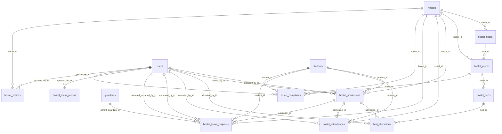

### `hostels`

*2 rows / 9 columns*

A residential building / facility belonging to the school.

**Points at:** `schools`

**Pointed at by:** `hostel_admissions`, `hostel_attendances`, `hostel_complaints`, `hostel_floors`, `hostel_incidents`, `hostel_leave_requests`, `hostel_notices`, `hostel_rooms`

**Unique on:** `school_id,code`

| Column | Type | Null | Notes |
|---|---|---|---|
| `name` | varchar(100) | no | - |
| `code` | varchar(20) | no | unique |
| `gender` | varchar(6) | no | - |
| `status` | varchar(20) | no | - |
| `description` | text | yes | - |
| `school_id` | bigint | no | -> `schools.id`, unique |
| `id` | bigint | no | primary key |
| `created_at` | timestamptz | no | default `now()` |
| `updated_at` | timestamptz | no | default `now()` |

### `hostel_floors`

*4 rows / 8 columns*

A floor within a hostel.

**Points at:** `hostels`, `schools`

**Pointed at by:** `hostel_rooms`

**Unique on:** `school_id,hostel_id,floor_number`

| Column | Type | Null | Notes |
|---|---|---|---|
| `hostel_id` | bigint | no | -> `hostels.id`, unique |
| `floor_number` | integer | no | unique |
| `floor_name` | varchar(60) | no | - |
| `status` | varchar(20) | no | - |
| `school_id` | bigint | no | -> `schools.id`, unique |
| `id` | bigint | no | primary key |
| `created_at` | timestamptz | no | default `now()` |
| `updated_at` | timestamptz | no | default `now()` |

### `hostel_rooms`

*10 rows / 10 columns*

A room on a floor with configurable bed capacity.

**Points at:** `hostel_floors`, `hostels`, `schools`

**Pointed at by:** `hostel_beds`, `hostel_complaints`

**Unique on:** `school_id,hostel_id,room_number`

| Column | Type | Null | Notes |
|---|---|---|---|
| `hostel_id` | bigint | no | -> `hostels.id`, unique |
| `floor_id` | bigint | no | -> `hostel_floors.id` |
| `room_number` | varchar(20) | no | unique |
| `capacity` | integer | no | - |
| `room_type` | varchar(30) | no | - |
| `status` | varchar(20) | no | - |
| `school_id` | bigint | no | -> `schools.id`, unique |
| `id` | bigint | no | primary key |
| `created_at` | timestamptz | no | default `now()` |
| `updated_at` | timestamptz | no | default `now()` |

### `hostel_beds`

*20 rows / 7 columns*

An explicit bed record inside a room.

**Points at:** `hostel_rooms`, `schools`

**Pointed at by:** `bed_allocations`

**Unique on:** `school_id,room_id,bed_number`

| Column | Type | Null | Notes |
|---|---|---|---|
| `room_id` | bigint | no | -> `hostel_rooms.id`, unique |
| `bed_number` | varchar(20) | no | unique |
| `status` | varchar(20) | no | - |
| `school_id` | bigint | no | -> `schools.id`, unique |
| `id` | bigint | no | primary key |
| `created_at` | timestamptz | no | default `now()` |
| `updated_at` | timestamptz | no | default `now()` |

### `hostel_admissions`

*20 rows / 13 columns*

Lifetime stay record of a student admitted to a hostel.

**Points at:** `hostels`, `schools`, `students`, `users`

**Pointed at by:** `bed_allocations`, `hostel_attendances`, `hostel_leave_requests`

| Column | Type | Null | Notes |
|---|---|---|---|
| `student_id` | bigint | no | -> `students.id` |
| `hostel_id` | bigint | no | -> `hostels.id` |
| `admission_date` | date | no | - |
| `status` | varchar(20) | no | - |
| `exit_date` | date | yes | - |
| `exit_reason` | text | yes | - |
| `remarks` | text | yes | - |
| `admitted_by_id` | bigint | yes | -> `users.id` |
| `exited_by_id` | bigint | yes | -> `users.id` |
| `school_id` | bigint | no | -> `schools.id` |
| `id` | bigint | no | primary key |
| `created_at` | timestamptz | no | default `now()` |
| `updated_at` | timestamptz | no | default `now()` |

### `bed_allocations`

*20 rows / 11 columns*

Historical and active bed allocations for a hostel admission.

**Points at:** `hostel_admissions`, `hostel_beds`, `schools`, `users`

| Column | Type | Null | Notes |
|---|---|---|---|
| `admission_id` | bigint | no | -> `hostel_admissions.id` |
| `bed_id` | bigint | no | -> `hostel_beds.id` |
| `allocated_at` | timestamptz | no | - |
| `vacated_at` | timestamptz | yes | - |
| `is_active` | boolean | no | - |
| `allocated_by_id` | bigint | yes | -> `users.id` |
| `remarks` | text | yes | - |
| `school_id` | bigint | no | -> `schools.id` |
| `id` | bigint | no | primary key |
| `created_at` | timestamptz | no | default `now()` |
| `updated_at` | timestamptz | no | default `now()` |

### `hostel_attendances`

*60 rows / 13 columns*

Residential 8:00 PM evening attendance marked by Wardens.

**Points at:** `hostel_admissions`, `hostels`, `schools`, `students`, `users`

**Unique on:** `school_id,hostel_id,student_id,attendance_date`

| Column | Type | Null | Notes |
|---|---|---|---|
| `hostel_id` | bigint | no | -> `hostels.id`, unique |
| `student_id` | bigint | no | -> `students.id`, unique |
| `admission_id` | bigint | no | -> `hostel_admissions.id` |
| `attendance_date` | date | no | unique |
| `status` | varchar(20) | no | - |
| `scheduled_time` | time without time zone | no | - |
| `recorded_at` | timestamptz | no | - |
| `recorded_by_id` | bigint | no | -> `users.id` |
| `remarks` | text | yes | - |
| `school_id` | bigint | no | -> `schools.id`, unique |
| `id` | bigint | no | primary key |
| `created_at` | timestamptz | no | default `now()` |
| `updated_at` | timestamptz | no | default `now()` |

### `hostel_leave_requests`

*2 rows / 21 columns*

Leave and outing requests initiated by parents and approved by wardens.

**Points at:** `guardians`, `hostel_admissions`, `hostels`, `schools`, `students`, `users`

| Column | Type | Null | Notes |
|---|---|---|---|
| `student_id` | bigint | no | -> `students.id` |
| `admission_id` | bigint | no | -> `hostel_admissions.id` |
| `hostel_id` | bigint | no | -> `hostels.id` |
| `request_type` | varchar(20) | no | - |
| `start_date` | date | no | - |
| `end_date` | date | no | - |
| `out_time` | time without time zone | yes | - |
| `expected_return_time` | timestamptz | no | - |
| `actual_return_time` | timestamptz | yes | - |
| `purpose` | text | no | - |
| `parent_guardian_id` | bigint | no | -> `guardians.id` |
| `status` | varchar(20) | no | - |
| `approved_by_id` | bigint | yes | -> `users.id` |
| `approved_at` | timestamptz | yes | - |
| `remarks` | text | yes | - |
| `rejection_reason` | text | yes | - |
| `returned_recorded_by_id` | bigint | yes | -> `users.id` |
| `school_id` | bigint | no | -> `schools.id` |
| `id` | bigint | no | primary key |
| `created_at` | timestamptz | no | default `now()` |
| `updated_at` | timestamptz | no | default `now()` |

### `hostel_mess_menus`

*6 rows / 11 columns*

School-wide weekly mess menu managed and published by Chief Provost.

**Points at:** `schools`, `users`

**Unique on:** `school_id,day_of_week`

| Column | Type | Null | Notes |
|---|---|---|---|
| `day_of_week` | varchar(3) | no | unique |
| `breakfast` | text | no | - |
| `lunch` | text | no | - |
| `snacks` | text | no | - |
| `dinner` | text | no | - |
| `is_published` | boolean | no | - |
| `updated_by_id` | bigint | yes | -> `users.id` |
| `school_id` | bigint | no | -> `schools.id`, unique |
| `id` | bigint | no | primary key |
| `created_at` | timestamptz | no | default `now()` |
| `updated_at` | timestamptz | no | default `now()` |

### `hostel_complaints`

*2 rows / 14 columns*

Hostel maintenance, cleanliness, and facilities complaints.

**Points at:** `hostel_rooms`, `hostels`, `schools`, `students`, `users`

| Column | Type | Null | Notes |
|---|---|---|---|
| `hostel_id` | bigint | no | -> `hostels.id` |
| `student_id` | bigint | yes | -> `students.id` |
| `room_id` | bigint | yes | -> `hostel_rooms.id` |
| `category` | varchar(50) | no | - |
| `title` | varchar(200) | no | - |
| `description` | text | no | - |
| `status` | varchar(20) | no | - |
| `resolution_remarks` | text | yes | - |
| `resolved_by_id` | bigint | yes | -> `users.id` |
| `resolved_at` | timestamptz | yes | - |
| `school_id` | bigint | no | -> `schools.id` |
| `id` | bigint | no | primary key |
| `created_at` | timestamptz | no | default `now()` |
| `updated_at` | timestamptz | no | default `now()` |

### `hostel_notices`

*2 rows / 11 columns*

Hostel-wide broadcast circulars and notices.

**Points at:** `hostels`, `schools`, `users`

| Column | Type | Null | Notes |
|---|---|---|---|
| `hostel_id` | bigint | yes | -> `hostels.id` |
| `title` | varchar(200) | no | - |
| `content` | text | no | - |
| `priority` | varchar(20) | no | - |
| `posted_by_id` | bigint | no | -> `users.id` |
| `posted_at` | timestamptz | no | - |
| `is_active` | boolean | no | - |
| `school_id` | bigint | no | -> `schools.id` |
| `id` | bigint | no | primary key |
| `created_at` | timestamptz | no | default `now()` |
| `updated_at` | timestamptz | no | default `now()` |

## System

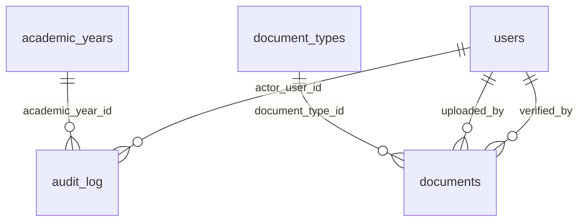

### `audit_log`

*263 rows / 15 columns*

Append-only. No update path, no delete path, never truncated.

**Points at:** `academic_years`, `schools`, `users`

| Column | Type | Null | Notes |
|---|---|---|---|
| `occurred_at` | timestamptz | no | - |
| `actor_user_id` | bigint | yes | -> `users.id` |
| `actor_label` | varchar(120) | yes | - |
| `entity_type` | varchar(40) | no | - |
| `entity_id` | bigint | yes | - |
| `action` | varchar(13) | no | - |
| `before` | json | yes | - |
| `after` | json | yes | - |
| `reason` | text | yes | - |
| `academic_year_id` | bigint | yes | -> `academic_years.id` |
| `ip` | varchar(45) | yes | - |
| `school_id` | bigint | no | -> `schools.id` |
| `id` | bigint | no | primary key |
| `created_at` | timestamptz | no | default `now()` |
| `updated_at` | timestamptz | no | default `now()` |

### `documents`

*13 rows / 24 columns*

An uploaded file attached to a student, an employee or a vehicle, with its
verification state and expiry. Deleted softly, so the audit entry still points
at something.

**Points at:** `document_types`, `schools`, `users`

**Unique on:** `file_key`

| Column | Type | Null | Notes |
|---|---|---|---|
| `owner_type` | varchar(11) | no | - |
| `owner_id` | bigint | no | - |
| `document_type_id` | bigint | yes | -> `document_types.id` |
| `file_key` | varchar(255) | no | unique |
| `file_name` | varchar(255) | no | - |
| `mime_type` | varchar(120) | no | - |
| `size_bytes` | bigint | no | - |
| `checksum` | varchar(64) | yes | - |
| `uploaded_by` | bigint | yes | -> `users.id` |
| `uploaded_at` | timestamptz | no | - |
| `status` | varchar(17) | no | - |
| `original_seen` | boolean | no | - |
| `verified_by` | bigint | yes | -> `users.id` |
| `verified_at` | timestamptz | yes | - |
| `rejection_reason` | text | yes | - |
| `expires_on` | date | yes | - |
| `is_confidential` | boolean | no | - |
| `deleted_at` | timestamptz | yes | - |
| `deleted_by` | bigint | yes | - |
| `delete_reason` | text | yes | - |
| `school_id` | bigint | no | -> `schools.id` |
| `id` | bigint | no | primary key |
| `created_at` | timestamptz | no | default `now()` |
| `updated_at` | timestamptz | no | default `now()` |

### `document_types`

*21 rows / 12 columns*

Configurable, not an enum: required-document lists change by class, by category
and by state regulation, and a school must be able to edit them without a deploy
(§3.8).

**Points at:** `schools`

**Pointed at by:** `documents`

**Unique on:** `school_id,code`

| Column | Type | Null | Notes |
|---|---|---|---|
| `code` | varchar(40) | no | unique |
| `name` | varchar(120) | no | - |
| `applies_to` | varchar(11) | no | - |
| `is_mandatory` | boolean | no | - |
| `required_if_category` | varchar(40) | yes | - |
| `has_expiry` | boolean | no | - |
| `is_confidential` | boolean | no | - |
| `sort_order` | integer | no | - |
| `school_id` | bigint | no | -> `schools.id`, unique |
| `id` | bigint | no | primary key |
| `created_at` | timestamptz | no | default `now()` |
| `updated_at` | timestamptz | no | default `now()` |

### `scheduled_jobs`

*5 rows / 10 columns*

A recurring job. Deliberately not cron syntax — a school needs "every day at
02:00", not "*/7 3-5 * * 2", and an interval plus an hour is far easier for a
non-technical administrator to read in a settings screen.

**Unique on:** `kind`

| Column | Type | Null | Notes |
|---|---|---|---|
| `kind` | varchar(48) | no | unique |
| `payload` | json | yes | - |
| `enabled` | boolean | no | - |
| `every_minutes` | integer | no | - |
| `at_hour` | integer | yes | - |
| `last_run_at` | timestamptz | yes | - |
| `next_run_at` | timestamptz | yes | - |
| `id` | bigint | no | primary key |
| `created_at` | timestamptz | no | default `now()` |
| `updated_at` | timestamptz | no | default `now()` |

---

# Part 2 - Tables not yet used (35)

These are empty in the demo school. Each belongs to a feature that is built and has working endpoints - admission has taken no applications, payroll has run no cycle, nobody has requested leave. The schema is real; only the rows are missing.

## People - students and guardians

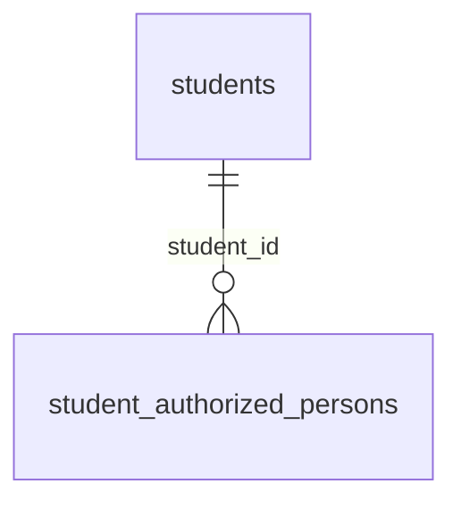

### `student_authorized_persons`

*0 rows / 13 columns*

Permanent authorized pickup roster on the student master record.

**Points at:** `schools`, `students`

| Column | Type | Null | Notes |
|---|---|---|---|
| `student_id` | bigint | no | -> `students.id` |
| `name` | varchar(120) | no | - |
| `relationship` | varchar(60) | no | - |
| `phone` | varchar(30) | no | - |
| `id_proof_type` | varchar(50) | yes | - |
| `id_proof_number` | varchar(50) | yes | - |
| `photo_url` | text | yes | - |
| `is_active` | boolean | no | - |
| `notes` | text | yes | - |
| `school_id` | bigint | no | -> `schools.id` |
| `id` | bigint | no | primary key |
| `created_at` | timestamptz | no | default `now()` |
| `updated_at` | timestamptz | no | default `now()` |

## Academics

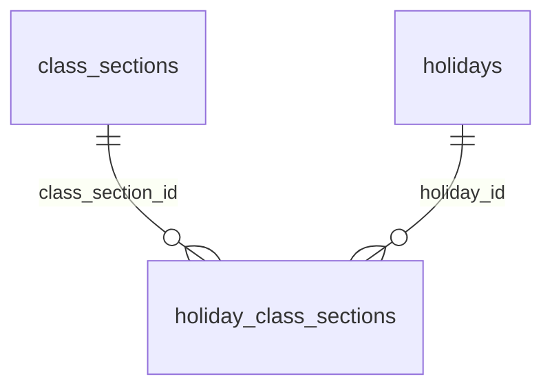

### `holiday_class_sections`

*0 rows / 6 columns*

Associates a holiday with specific class sections when not school-wide.

**Points at:** `class_sections`, `holidays`, `schools`

**Unique on:** `holiday_id,class_section_id`

| Column | Type | Null | Notes |
|---|---|---|---|
| `holiday_id` | bigint | no | -> `holidays.id`, unique |
| `class_section_id` | bigint | no | -> `class_sections.id`, unique |
| `school_id` | bigint | no | -> `schools.id` |
| `id` | bigint | no | primary key |
| `created_at` | timestamptz | no | default `now()` |
| `updated_at` | timestamptz | no | default `now()` |

## Attendance

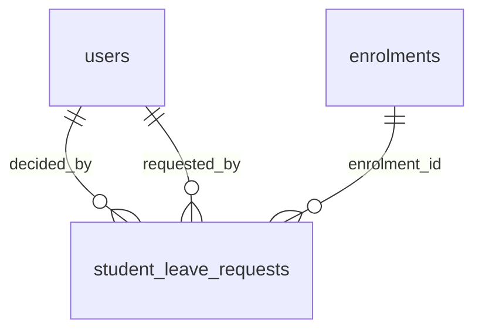

### `student_leave_requests`

*0 rows / 14 columns*

A guardian asking for a child to be away (§5.8.5).

**Points at:** `enrolments`, `schools`, `users`

| Column | Type | Null | Notes |
|---|---|---|---|
| `enrolment_id` | bigint | no | -> `enrolments.id` |
| `from_date` | date | no | - |
| `to_date` | date | no | - |
| `type` | varchar(9) | no | - |
| `reason` | text | no | - |
| `status` | varchar(9) | no | - |
| `requested_by` | bigint | yes | -> `users.id` |
| `decided_by` | bigint | yes | -> `users.id` |
| `decided_at` | timestamptz | yes | - |
| `decision_note` | text | yes | - |
| `school_id` | bigint | no | -> `schools.id` |
| `id` | bigint | no | primary key |
| `created_at` | timestamptz | no | default `now()` |
| `updated_at` | timestamptz | no | default `now()` |

## Examinations and results

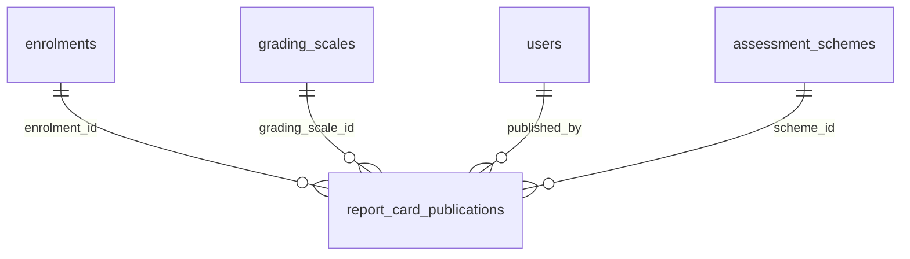

### `report_card_publications`

*0 rows / 13 columns*

A published report card: frozen, numbered, and citing its own rules.

**Points at:** `assessment_schemes`, `enrolments`, `grading_scales`, `schools`, `users`

**Unique on:** `enrolment_id,term`

| Column | Type | Null | Notes |
|---|---|---|---|
| `enrolment_id` | bigint | no | -> `enrolments.id`, unique |
| `term` | varchar(20) | no | unique |
| `scheme_id` | bigint | no | -> `assessment_schemes.id` |
| `grading_scale_id` | bigint | no | -> `grading_scales.id` |
| `document_no` | varchar(32) | no | - |
| `published_at` | timestamptz | no | - |
| `published_by` | bigint | yes | -> `users.id` |
| `result_status` | varchar(20) | no | - |
| `payload` | json | no | - |
| `school_id` | bigint | no | -> `schools.id` |
| `id` | bigint | no | primary key |
| `created_at` | timestamptz | no | default `now()` |
| `updated_at` | timestamptz | no | default `now()` |

## Fees and money

```mermaid
erDiagram
    users ||--o{ student_fee_plans : "assigned_by"
    enrolments ||--o{ student_fee_plans : "enrolment_id"
    fee_plans ||--o{ student_fee_plans : "fee_plan_id"
    users ||--o{ fee_periods : "closed_by"
```

### `student_fee_plans`

*0 rows / 7 columns*

An individual override of the class default. Keyed to the enrolment, not the
student: what a child is charged is a fact about a year (§3.2).

**Points at:** `enrolments`, `fee_plans`, `schools`, `users`

**Unique on:** `enrolment_id`

| Column | Type | Null | Notes |
|---|---|---|---|
| `enrolment_id` | bigint | no | -> `enrolments.id`, unique |
| `fee_plan_id` | bigint | no | -> `fee_plans.id` |
| `assigned_by` | bigint | yes | -> `users.id` |
| `school_id` | bigint | no | -> `schools.id` |
| `id` | bigint | no | primary key |
| `created_at` | timestamptz | no | default `now()` |
| `updated_at` | timestamptz | no | default `now()` |

### `fee_periods`

*0 rows / 10 columns*

One billing month's books, open or closed.

**Points at:** `schools`, `users`

**Unique on:** `school_id,period_year,period_month`

| Column | Type | Null | Notes |
|---|---|---|---|
| `period_year` | integer | no | unique |
| `period_month` | integer | no | unique |
| `status` | varchar(6) | no | - |
| `closed_by` | bigint | yes | -> `users.id` |
| `closed_at` | timestamptz | yes | - |
| `note` | text | yes | - |
| `school_id` | bigint | no | -> `schools.id`, unique |
| `id` | bigint | no | primary key |
| `created_at` | timestamptz | no | default `now()` |
| `updated_at` | timestamptz | no | default `now()` |

## HR and payroll

```mermaid
erDiagram
    academic_years ||--o{ leave_balances : "academic_year_id"
    employees ||--o{ leave_balances : "employee_id"
    leave_types ||--o{ leave_balances : "leave_type_id"
    salary_components ||--o{ salary_structure_items : "component_id"
    salary_structures ||--o{ salary_structure_items : "structure_id"
    users ||--o{ payroll_runs : "approved_by"
    employees ||--o{ payslips : "employee_id"
    payroll_runs ||--o{ payslips : "run_id"
    salary_components ||--o{ payslip_lines : "component_id"
    payslips ||--o{ payslip_lines : "payslip_id"
```

### `leave_balances`

*0 rows / 9 columns*

What one employee has left of one type, this year.

**Points at:** `academic_years`, `employees`, `leave_types`, `schools`

**Unique on:** `employee_id,leave_type_id,academic_year_id`

| Column | Type | Null | Notes |
|---|---|---|---|
| `employee_id` | bigint | no | -> `employees.id`, unique |
| `leave_type_id` | bigint | no | -> `leave_types.id`, unique |
| `academic_year_id` | bigint | no | -> `academic_years.id`, unique |
| `entitled` | numeric(5,1) | no | - |
| `used` | numeric(5,1) | no | - |
| `school_id` | bigint | no | -> `schools.id` |
| `id` | bigint | no | primary key |
| `created_at` | timestamptz | no | default `now()` |
| `updated_at` | timestamptz | no | default `now()` |

### `salary_structure_items`

*0 rows / 8 columns*

A per-employee override of one component's value.

**Points at:** `salary_components`, `salary_structures`, `schools`

**Unique on:** `structure_id,component_id`

| Column | Type | Null | Notes |
|---|---|---|---|
| `structure_id` | bigint | no | -> `salary_structures.id`, unique |
| `component_id` | bigint | no | -> `salary_components.id`, unique |
| `value` | numeric(12,2) | no | - |
| `included` | boolean | no | - |
| `school_id` | bigint | no | -> `schools.id` |
| `id` | bigint | no | primary key |
| `created_at` | timestamptz | no | default `now()` |
| `updated_at` | timestamptz | no | default `now()` |

### `payroll_runs`

*0 rows / 15 columns*

One month's payroll, once.

**Points at:** `schools`, `users`

**Pointed at by:** `payslips`

**Unique on:** `school_id,year,month,run_no`

| Column | Type | Null | Notes |
|---|---|---|---|
| `year` | integer | no | unique |
| `month` | integer | no | unique |
| `run_no` | integer | no | unique |
| `is_supplementary` | boolean | no | - |
| `status` | varchar(10) | no | - |
| `working_days` | integer | yes | - |
| `calculated_at` | timestamptz | yes | - |
| `approved_at` | timestamptz | yes | - |
| `approved_by` | bigint | yes | -> `users.id` |
| `paid_at` | timestamptz | yes | - |
| `note` | text | yes | - |
| `school_id` | bigint | no | -> `schools.id`, unique |
| `id` | bigint | no | primary key |
| `created_at` | timestamptz | no | default `now()` |
| `updated_at` | timestamptz | no | default `now()` |

### `payslips`

*0 rows / 14 columns*

One person, one run. The totals are stored, not derived on read.

**Points at:** `employees`, `payroll_runs`, `schools`

**Pointed at by:** `payslip_lines`

**Unique on:** `run_id,employee_id`, `school_id,payslip_no`

| Column | Type | Null | Notes |
|---|---|---|---|
| `run_id` | bigint | no | -> `payroll_runs.id`, unique |
| `employee_id` | bigint | no | -> `employees.id`, unique |
| `payslip_no` | varchar(32) | no | unique |
| `working_days` | integer | no | - |
| `lop_days` | numeric(5,1) | no | - |
| `monthly_gross` | numeric(12,2) | no | - |
| `total_earnings` | numeric(12,2) | no | - |
| `total_deductions` | numeric(12,2) | no | - |
| `net_pay` | numeric(12,2) | no | - |
| `employer_cost` | numeric(12,2) | no | - |
| `school_id` | bigint | no | -> `schools.id`, unique |
| `id` | bigint | no | primary key |
| `created_at` | timestamptz | no | default `now()` |
| `updated_at` | timestamptz | no | default `now()` |

### `payslip_lines`

*0 rows / 11 columns*

One component on one payslip, as it was computed.

**Points at:** `payslips`, `salary_components`, `schools`

**Unique on:** `payslip_id,code`

| Column | Type | Null | Notes |
|---|---|---|---|
| `payslip_id` | bigint | no | -> `payslips.id`, unique |
| `component_id` | bigint | yes | -> `salary_components.id` |
| `code` | varchar(16) | no | unique |
| `name` | varchar(60) | no | - |
| `type` | varchar(21) | no | - |
| `amount` | numeric(12,2) | no | - |
| `sequence` | integer | no | - |
| `school_id` | bigint | no | -> `schools.id` |
| `id` | bigint | no | primary key |
| `created_at` | timestamptz | no | default `now()` |
| `updated_at` | timestamptz | no | default `now()` |

## Admission

```mermaid
erDiagram
    users ||--o{ enquiry_interactions : "by_user_id"
    enquiries ||--o{ enquiry_interactions : "enquiry_id"
    applications ||--o{ application_guardians : "application_id"
    employees ||--o{ application_guardians : "employee_id"
    applications ||--o{ application_siblings : "application_id"
    students ||--o{ application_siblings : "student_id"
    applications ||--o{ application_medical : "application_id"
    applications ||--o{ application_payments : "application_id"
    users ||--o{ application_payments : "collected_by"
    applications ||--o{ application_authorized_persons : "application_id"
    applications ||--o{ application_document_overrides : "application_id"
    users ||--o{ application_document_overrides : "authorized_by_id"
    applications ||--o{ assessments : "application_id"
    users ||--o{ assessments : "evaluated_by"
    assessments ||--o{ assessment_subjects : "assessment_id"
    applications ||--o{ interviews : "application_id"
    users ||--o{ interviews : "conducted_by"
    applications ||--o{ admission_decisions : "application_id"
    users ||--o{ admission_decisions : "decided_by"
    applications ||--o{ admission_offers : "application_id"
    applications ||--o{ waitlist_entries : "application_id"
    admission_cycles ||--o{ waitlist_entries : "cycle_id"
```

### `enquiry_interactions`

*0 rows / 10 columns*

One logged contact. Append-only in practice: the follow-up history is the
evidence behind a conversion number.

**Points at:** `enquiries`, `schools`, `users`

| Column | Type | Null | Notes |
|---|---|---|---|
| `enquiry_id` | bigint | no | -> `enquiries.id` |
| `occurred_at` | timestamptz | no | - |
| `channel` | varchar(8) | no | - |
| `notes` | text | yes | - |
| `outcome` | varchar(23) | yes | - |
| `by_user_id` | bigint | yes | -> `users.id` |
| `school_id` | bigint | no | -> `schools.id` |
| `id` | bigint | no | primary key |
| `created_at` | timestamptz | no | default `now()` |
| `updated_at` | timestamptz | no | default `now()` |

### `application_guardians`

*0 rows / 24 columns*

Repeatable: father, mother, guardian (§5.1.4 step 3).

**Points at:** `applications`, `employees`, `schools`

| Column | Type | Null | Notes |
|---|---|---|---|
| `application_id` | bigint | no | -> `applications.id` |
| `relation` | varchar(14) | no | - |
| `full_name` | varchar(120) | no | - |
| `date_of_birth` | date | yes | - |
| `qualification` | varchar(120) | yes | - |
| `occupation` | varchar(80) | yes | - |
| `designation` | varchar(80) | yes | - |
| `organisation` | varchar(120) | yes | - |
| `annual_income_band` | varchar(40) | yes | - |
| `office_address` | text | yes | - |
| `mobile` | varchar(20) | no | - |
| `alternate_mobile` | varchar(20) | yes | - |
| `email` | varchar(160) | yes | - |
| `is_primary` | boolean | no | - |
| `is_emergency_contact` | boolean | no | - |
| `is_authorised_for_pickup` | boolean | no | - |
| `photo_url` | text | yes | - |
| `is_school_alumnus` | boolean | no | - |
| `is_school_staff` | boolean | no | - |
| `employee_id` | bigint | yes | -> `employees.id` |
| `school_id` | bigint | no | -> `schools.id` |
| `id` | bigint | no | primary key |
| `created_at` | timestamptz | no | default `now()` |
| `updated_at` | timestamptz | no | default `now()` |

### `application_siblings`

*0 rows / 9 columns*

Step 4. A sibling already in the school is a link to a real student, never free
text, because it drives a fee concession.

**Points at:** `applications`, `schools`, `students`

| Column | Type | Null | Notes |
|---|---|---|---|
| `application_id` | bigint | no | -> `applications.id` |
| `student_id` | bigint | yes | -> `students.id` |
| `name` | varchar(120) | yes | - |
| `age` | integer | yes | - |
| `school_name` | varchar(160) | yes | - |
| `school_id` | bigint | no | -> `schools.id` |
| `id` | bigint | no | primary key |
| `created_at` | timestamptz | no | default `now()` |
| `updated_at` | timestamptz | no | default `now()` |

### `application_medical`

*0 rows / 15 columns*

Step 7, in its own table because §15 requires it to be permission-gated
separately from everything else on the application.

**Points at:** `applications`, `schools`

**Unique on:** `application_id`

| Column | Type | Null | Notes |
|---|---|---|---|
| `application_id` | bigint | no | -> `applications.id`, unique |
| `blood_group` | varchar(8) | yes | - |
| `known_allergies` | text | yes | - |
| `chronic_conditions` | text | yes | - |
| `regular_medication` | text | yes | - |
| `physical_disability` | text | yes | - |
| `learning_needs` | text | yes | - |
| `vision_hearing_notes` | text | yes | - |
| `emergency_doctor` | varchar(160) | yes | - |
| `emergency_doctor_phone` | varchar(20) | yes | - |
| `consent_for_emergency_treatment` | boolean | no | - |
| `school_id` | bigint | no | -> `schools.id` |
| `id` | bigint | no | primary key |
| `created_at` | timestamptz | no | default `now()` |
| `updated_at` | timestamptz | no | default `now()` |

### `application_payments`

*0 rows / 15 columns*

The application fee paid against an application. Separate from `fee_payments`
because an applicant is not a student and has no enrolment.

**Points at:** `applications`, `schools`, `users`

**Unique on:** `idempotency_key`, `school_id,receipt_no`

| Column | Type | Null | Notes |
|---|---|---|---|
| `application_id` | bigint | no | -> `applications.id` |
| `purpose` | varchar(15) | no | - |
| `amount` | numeric(10,2) | no | - |
| `method` | varchar(20) | no | - |
| `reference` | varchar(80) | yes | - |
| `receipt_no` | varchar(24) | no | unique |
| `paid_at` | timestamptz | no | - |
| `collected_by` | bigint | yes | -> `users.id` |
| `status` | varchar(8) | no | - |
| `void_reason` | text | yes | - |
| `idempotency_key` | varchar(120) | yes | unique |
| `school_id` | bigint | no | -> `schools.id`, unique |
| `id` | bigint | no | primary key |
| `created_at` | timestamptz | no | default `now()` |
| `updated_at` | timestamptz | no | default `now()` |

### `application_authorized_persons`

*0 rows / 12 columns*

Repeatable: authorized pickup persons permitted to collect the student (§5.1.4
step 3). Supports multiple people (parents, grandparents, drivers, relatives)
with genuine photos.

**Points at:** `applications`, `schools`

| Column | Type | Null | Notes |
|---|---|---|---|
| `application_id` | bigint | no | -> `applications.id` |
| `name` | varchar(120) | no | - |
| `relationship` | varchar(60) | no | - |
| `phone` | varchar(30) | no | - |
| `id_proof_type` | varchar(50) | yes | - |
| `id_proof_number` | varchar(50) | yes | - |
| `photo_url` | text | yes | - |
| `notes` | text | yes | - |
| `school_id` | bigint | no | -> `schools.id` |
| `id` | bigint | no | primary key |
| `created_at` | timestamptz | no | default `now()` |
| `updated_at` | timestamptz | no | default `now()` |

### `application_document_overrides`

*0 rows / 11 columns*

An authorized Admin exception permitting an application to be submitted or
processed despite missing a mandatory document (e.g. birth certificate, APAAR).

**Points at:** `applications`, `schools`, `users`

**Unique on:** `application_id,document_code`

| Column | Type | Null | Notes |
|---|---|---|---|
| `application_id` | bigint | no | -> `applications.id`, unique |
| `document_code` | varchar(40) | no | unique |
| `status` | varchar(20) | no | default `'pending'` |
| `authorized_by_id` | bigint | yes | -> `users.id` |
| `reason` | text | no | - |
| `rejection_reason` | text | yes | - |
| `authorized_at` | timestamptz | yes | - |
| `school_id` | bigint | no | -> `schools.id` |
| `id` | bigint | no | primary key |
| `created_at` | timestamptz | no | default `now()` |
| `updated_at` | timestamptz | no | default `now()` |

### `assessments`

*0 rows / 15 columns*

One test or observation for one applicant.

**Points at:** `applications`, `schools`, `users`

**Pointed at by:** `assessment_subjects`

| Column | Type | Null | Notes |
|---|---|---|---|
| `application_id` | bigint | no | -> `applications.id` |
| `assessment_type` | varchar(22) | no | - |
| `scheduled_at` | timestamptz | no | - |
| `venue` | varchar(80) | yes | - |
| `seat_no` | varchar(16) | yes | - |
| `status` | varchar(9) | no | - |
| `total_marks` | numeric(6,2) | yes | - |
| `obtained_marks` | numeric(6,2) | yes | - |
| `is_absent` | boolean | no | - |
| `evaluated_by` | bigint | yes | -> `users.id` |
| `remarks` | text | yes | - |
| `school_id` | bigint | no | -> `schools.id` |
| `id` | bigint | no | primary key |
| `created_at` | timestamptz | no | default `now()` |
| `updated_at` | timestamptz | no | default `now()` |

### `assessment_subjects`

*0 rows / 8 columns*

Subject-wise marks, for the assessments that have subjects at all.

**Points at:** `assessments`, `schools`

**Unique on:** `assessment_id,subject`

| Column | Type | Null | Notes |
|---|---|---|---|
| `assessment_id` | bigint | no | -> `assessments.id`, unique |
| `subject` | varchar(60) | no | unique |
| `max_marks` | numeric(6,2) | no | - |
| `obtained` | numeric(6,2) | yes | - |
| `school_id` | bigint | no | -> `schools.id` |
| `id` | bigint | no | primary key |
| `created_at` | timestamptz | no | default `now()` |
| `updated_at` | timestamptz | no | default `now()` |

### `interviews`

*0 rows / 15 columns*

An admission interview: when, with whom, and what was concluded.

**Points at:** `applications`, `schools`, `users`

| Column | Type | Null | Notes |
|---|---|---|---|
| `application_id` | bigint | no | -> `applications.id` |
| `scheduled_at` | timestamptz | no | - |
| `venue` | varchar(80) | yes | - |
| `panel_member_ids` | json | yes | - |
| `status` | varchar(9) | no | - |
| `structured_scores` | json | yes | - |
| `child_rating` | integer | yes | - |
| `parent_rating` | integer | yes | - |
| `recommendation` | varchar(12) | yes | - |
| `notes` | text | yes | - |
| `conducted_by` | bigint | yes | -> `users.id` |
| `school_id` | bigint | no | -> `schools.id` |
| `id` | bigint | no | primary key |
| `created_at` | timestamptz | no | default `now()` |
| `updated_at` | timestamptz | no | default `now()` |

### `admission_decisions`

*0 rows / 12 columns*

Append-only. A reversal is a new row, not an edit of the old one — the history
of who decided what, and why, is the whole point (§5.1.9(13)).

**Points at:** `applications`, `schools`, `users`

| Column | Type | Null | Notes |
|---|---|---|---|
| `application_id` | bigint | no | -> `applications.id` |
| `decision` | varchar(10) | no | - |
| `decided_by` | bigint | yes | -> `users.id` |
| `decided_at` | timestamptz | no | - |
| `reason` | text | no | - |
| `seat_category` | varchar(20) | yes | - |
| `conditions` | text | yes | - |
| `over_allocation_approved` | boolean | no | - |
| `school_id` | bigint | no | -> `schools.id` |
| `id` | bigint | no | primary key |
| `created_at` | timestamptz | no | default `now()` |
| `updated_at` | timestamptz | no | default `now()` |

### `admission_offers`

*0 rows / 11 columns*

An offer of a place made to an applicant, with its expiry and whether it was
taken up.

**Points at:** `applications`, `schools`

| Column | Type | Null | Notes |
|---|---|---|---|
| `application_id` | bigint | no | -> `applications.id` |
| `offered_at` | timestamptz | no | - |
| `expires_on` | date | no | - |
| `offer_amount` | numeric(10,2) | yes | - |
| `status` | varchar(9) | no | - |
| `accepted_at` | timestamptz | yes | - |
| `released_at` | timestamptz | yes | - |
| `school_id` | bigint | no | -> `schools.id` |
| `id` | bigint | no | primary key |
| `created_at` | timestamptz | no | default `now()` |
| `updated_at` | timestamptz | no | default `now()` |

### `waitlist_entries`

*0 rows / 9 columns*

An ordered queue per class, not a label on an application.

**Points at:** `admission_cycles`, `applications`, `schools`

**Unique on:** `application_id`, `cycle_id,class_name,rank`

| Column | Type | Null | Notes |
|---|---|---|---|
| `cycle_id` | bigint | no | -> `admission_cycles.id`, unique |
| `class_name` | varchar(8) | no | unique |
| `application_id` | bigint | no | -> `applications.id`, unique |
| `rank` | integer | no | unique |
| `status` | varchar(9) | no | - |
| `school_id` | bigint | no | -> `schools.id` |
| `id` | bigint | no | primary key |
| `created_at` | timestamptz | no | default `now()` |
| `updated_at` | timestamptz | no | default `now()` |

## Certificates

```mermaid
erDiagram
    users ||--o{ student_certificates : "approved_by_id"
    enrolments ||--o{ student_certificates : "enrolment_id"
    users ||--o{ student_certificates : "issued_by_id"
    users ||--o{ student_certificates : "requested_by_id"
    students ||--o{ student_certificates : "student_id"
```

### `student_certificates`

*0 rows / 22 columns*

An official certificate issued to or requested for a student. Maintains an
immutable issuance history, request/approval status, and audit records.

**Points at:** `enrolments`, `schools`, `student_certificates`, `students`, `users`

**Unique on:** `school_id,certificate_no`

| Column | Type | Null | Notes |
|---|---|---|---|
| `certificate_type` | varchar(30) | no | - |
| `student_id` | bigint | no | -> `students.id` |
| `enrolment_id` | bigint | no | -> `enrolments.id` |
| `certificate_no` | varchar(40) | yes | unique |
| `issue_date` | date | yes | - |
| `issued_by_id` | bigint | yes | -> `users.id` |
| `issued_at` | timestamptz | yes | - |
| `status` | varchar(20) | no | - |
| `requested_by_id` | bigint | yes | -> `users.id` |
| `requested_at` | timestamptz | yes | - |
| `approved_by_id` | bigint | yes | -> `users.id` |
| `approved_at` | timestamptz | yes | - |
| `rejection_reason` | text | yes | - |
| `data_snapshot` | json | no | - |
| `is_reissue` | boolean | no | default `false` |
| `reissue_count` | integer | no | default `0` |
| `reissue_reason` | text | yes | - |
| `original_certificate_id` | bigint | yes | -> `student_certificates.id` |
| `school_id` | bigint | no | -> `schools.id`, unique |
| `id` | bigint | no | primary key |
| `created_at` | timestamptz | no | default `now()` |
| `updated_at` | timestamptz | no | default `now()` |

## Reception and front desk

```mermaid
erDiagram
    users ||--o{ student_passes : "issued_by_id"
    students ||--o{ student_passes : "student_id"
    users ||--o{ principal_meeting_requests : "created_by_id"
    students ||--o{ found_items : "claimed_by_student_id"
    users ||--o{ found_items : "collected_by_staff_id"
    users ||--o{ found_items : "recorded_by_id"
```

### `student_passes`

*0 rows / 20 columns*

One-time student gate pass generated on behalf of a parent.

**Points at:** `schools`, `students`, `users`

| Column | Type | Null | Notes |
|---|---|---|---|
| `pass_code` | varchar(40) | no | - |
| `student_id` | bigint | no | -> `students.id` |
| `student_name` | varchar(120) | no | - |
| `admission_no` | varchar(50) | no | - |
| `class_name` | varchar(60) | yes | - |
| `reason` | text | no | - |
| `pickup_person_name` | varchar(120) | no | - |
| `pickup_person_relation` | varchar(60) | no | - |
| `pickup_person_phone` | varchar(30) | no | - |
| `pickup_person_id_proof` | varchar(80) | yes | - |
| `pass_date` | date | no | - |
| `pass_time` | varchar(20) | no | - |
| `issued_by_id` | bigint | no | -> `users.id` |
| `issued_by_name` | varchar(120) | no | - |
| `status` | varchar(30) | no | - |
| `remarks` | text | yes | - |
| `school_id` | bigint | no | -> `schools.id` |
| `id` | bigint | no | primary key |
| `created_at` | timestamptz | no | default `now()` |
| `updated_at` | timestamptz | no | default `now()` |

### `principal_meeting_requests`

*0 rows / 19 columns*

Visitor meeting slips/requests for the Principal.

**Points at:** `schools`, `users`

| Column | Type | Null | Notes |
|---|---|---|---|
| `slip_code` | varchar(40) | no | - |
| `visitor_name` | varchar(120) | no | - |
| `visitor_phone` | varchar(30) | no | - |
| `visitor_organization` | varchar(120) | yes | - |
| `student_name` | varchar(120) | yes | - |
| `student_admission_no` | varchar(50) | yes | - |
| `reason` | text | no | - |
| `meeting_date` | date | no | - |
| `meeting_time` | varchar(20) | no | - |
| `status` | varchar(30) | no | - |
| `wait_duration_minutes` | integer | yes | - |
| `response_notes` | text | yes | - |
| `responded_at` | timestamptz | yes | - |
| `created_by_id` | bigint | no | -> `users.id` |
| `created_by_name` | varchar(120) | no | - |
| `school_id` | bigint | no | -> `schools.id` |
| `id` | bigint | no | primary key |
| `created_at` | timestamptz | no | default `now()` |
| `updated_at` | timestamptz | no | default `now()` |

### `found_items`

*0 rows / 24 columns*

Items found on school premises and managed by the receptionist.

**Points at:** `schools`, `students`, `users`

| Column | Type | Null | Notes |
|---|---|---|---|
| `item_name` | varchar(150) | no | - |
| `category` | varchar(50) | no | - |
| `description` | text | yes | - |
| `found_location` | varchar(150) | no | - |
| `found_date` | date | no | - |
| `found_time` | varchar(20) | yes | - |
| `recorded_by_id` | bigint | no | -> `users.id` |
| `recorded_by_name` | varchar(120) | no | - |
| `photo_url` | text | yes | - |
| `status` | varchar(30) | no | - |
| `broadcasted_at` | timestamptz | yes | - |
| `claimed_by_student_id` | bigint | yes | -> `students.id` |
| `claimed_by_student_name` | varchar(120) | yes | - |
| `claimed_by_admission_no` | varchar(50) | yes | - |
| `claimed_by_class_name` | varchar(50) | yes | - |
| `handover_photo_url` | text | yes | - |
| `handover_notes` | text | yes | - |
| `collected_at` | timestamptz | yes | - |
| `collected_by_staff_id` | bigint | yes | -> `users.id` |
| `collected_by_staff_name` | varchar(120) | yes | - |
| `school_id` | bigint | no | -> `schools.id` |
| `id` | bigint | no | primary key |
| `created_at` | timestamptz | no | default `now()` |
| `updated_at` | timestamptz | no | default `now()` |

### `directory_contacts`

*0 rows / 15 columns*

Important emergency and administrative contacts for the school.

**Points at:** `schools`

| Column | Type | Null | Notes |
|---|---|---|---|
| `category` | varchar(60) | no | - |
| `name` | varchar(150) | no | - |
| `designation_or_department` | varchar(120) | yes | - |
| `phone_primary` | varchar(40) | no | - |
| `phone_secondary` | varchar(40) | yes | - |
| `email` | varchar(120) | yes | - |
| `address` | text | yes | - |
| `operating_hours` | varchar(100) | yes | - |
| `is_emergency` | boolean | no | - |
| `display_order` | integer | no | - |
| `notes` | text | yes | - |
| `school_id` | bigint | no | -> `schools.id` |
| `id` | bigint | no | primary key |
| `created_at` | timestamptz | no | default `now()` |
| `updated_at` | timestamptz | no | default `now()` |

## Communication

```mermaid
erDiagram
    users ||--o{ messages : "approved_by"
    users ||--o{ messages : "created_by"
    message_templates ||--o{ messages : "template_id"
    applications ||--o{ message_recipients : "application_id"
    guardians ||--o{ message_recipients : "guardian_id"
    messages ||--o{ message_recipients : "message_id"
    students ||--o{ message_recipients : "student_id"
    users ||--o{ message_recipients : "user_id"
    users ||--o{ notification_preferences : "user_id"
    students ||--o{ alert_views : "student_id"
    users ||--o{ alert_views : "user_id"
```

### `messages`

*0 rows / 17 columns*

One send: a body, an audience, and a status.

**Points at:** `message_templates`, `schools`, `users`

**Pointed at by:** `message_recipients`, `notices`

| Column | Type | Null | Notes |
|---|---|---|---|
| `category` | varchar(11) | no | - |
| `channel` | varchar(8) | no | - |
| `template_id` | bigint | yes | -> `message_templates.id` |
| `template_version` | integer | yes | - |
| `subject` | varchar(200) | no | - |
| `body` | text | no | - |
| `audience` | json | no | - |
| `status` | varchar(9) | no | - |
| `scheduled_for` | timestamptz | yes | - |
| `sent_at` | timestamptz | yes | - |
| `created_by` | bigint | yes | -> `users.id` |
| `approved_by` | bigint | yes | -> `users.id` |
| `approved_at` | timestamptz | yes | - |
| `school_id` | bigint | no | -> `schools.id` |
| `id` | bigint | no | primary key |
| `created_at` | timestamptz | no | default `now()` |
| `updated_at` | timestamptz | no | default `now()` |

### `message_recipients`

*0 rows / 17 columns*

One person, one address, one delivery outcome.

**Points at:** `applications`, `guardians`, `messages`, `schools`, `students`, `users`

| Column | Type | Null | Notes |
|---|---|---|---|
| `message_id` | bigint | no | -> `messages.id` |
| `user_id` | bigint | yes | -> `users.id` |
| `guardian_id` | bigint | yes | -> `guardians.id` |
| `student_id` | bigint | yes | -> `students.id` |
| `application_id` | bigint | yes | -> `applications.id` |
| `to_address` | varchar(200) | no | - |
| `channel` | varchar(8) | no | - |
| `context` | json | no | - |
| `status` | varchar(9) | no | - |
| `attempts` | integer | no | - |
| `sent_at` | timestamptz | yes | - |
| `failure_reason` | text | yes | - |
| `provider_ref` | varchar(120) | yes | - |
| `school_id` | bigint | no | -> `schools.id` |
| `id` | bigint | no | primary key |
| `created_at` | timestamptz | no | default `now()` |
| `updated_at` | timestamptz | no | default `now()` |

### `notification_preferences`

*0 rows / 8 columns*

One opt-out, per person per category per channel.

**Points at:** `schools`, `users`

**Unique on:** `user_id,category,channel`

| Column | Type | Null | Notes |
|---|---|---|---|
| `user_id` | bigint | no | -> `users.id`, unique |
| `category` | varchar(11) | no | unique |
| `channel` | varchar(8) | no | unique |
| `opted_out` | boolean | no | - |
| `school_id` | bigint | no | -> `schools.id` |
| `id` | bigint | no | primary key |
| `created_at` | timestamptz | no | default `now()` |
| `updated_at` | timestamptz | no | default `now()` |

### `alert_views`

*0 rows / 9 columns*

Tracks viewed/dismissed status of important alerts per user, child, and alert
event.

**Points at:** `schools`, `students`, `users`

**Unique on:** `school_id,user_id,student_id,alert_type,event_key`

| Column | Type | Null | Notes |
|---|---|---|---|
| `user_id` | bigint | no | -> `users.id`, unique |
| `student_id` | bigint | no | -> `students.id`, unique |
| `alert_type` | varchar(50) | no | unique |
| `event_key` | varchar(100) | no | unique |
| `viewed_at` | timestamptz | no | - |
| `school_id` | bigint | no | -> `schools.id`, unique |
| `id` | bigint | no | primary key |
| `created_at` | timestamptz | no | default `now()` |
| `updated_at` | timestamptz | no | default `now()` |

## Hostel and mess

```mermaid
erDiagram
    hostels ||--o{ hostel_incidents : "hostel_id"
    users ||--o{ hostel_incidents : "reported_by_id"
    students ||--o{ hostel_incidents : "student_id"
```

### `hostel_incidents`

*0 rows / 13 columns*

Disciplinary and welfare incidents recorded in hostels.

**Points at:** `hostels`, `schools`, `students`, `users`

| Column | Type | Null | Notes |
|---|---|---|---|
| `hostel_id` | bigint | no | -> `hostels.id` |
| `student_id` | bigint | yes | -> `students.id` |
| `title` | varchar(200) | no | - |
| `description` | text | no | - |
| `severity` | varchar(20) | no | - |
| `incident_date` | date | no | - |
| `action_taken` | text | yes | - |
| `reported_by_id` | bigint | no | -> `users.id` |
| `status` | varchar(20) | no | - |
| `school_id` | bigint | no | -> `schools.id` |
| `id` | bigint | no | primary key |
| `created_at` | timestamptz | no | default `now()` |
| `updated_at` | timestamptz | no | default `now()` |

## System

### `jobs`

*0 rows / 16 columns*

The background work queue - messages to send, report cards to build. Drained by
`worker.py`.

**Points at:** `schools`

**Unique on:** `idempotency_key`

| Column | Type | Null | Notes |
|---|---|---|---|
| `kind` | varchar(48) | no | - |
| `payload` | json | yes | - |
| `status` | varchar(9) | no | - |
| `run_after` | timestamptz | no | - |
| `started_at` | timestamptz | yes | - |
| `finished_at` | timestamptz | yes | - |
| `attempts` | integer | no | - |
| `max_attempts` | integer | no | - |
| `last_error` | text | yes | - |
| `result` | json | yes | - |
| `idempotency_key` | varchar(120) | yes | unique |
| `requested_by` | bigint | yes | - |
| `school_id` | bigint | no | -> `schools.id` |
| `id` | bigint | no | primary key |
| `created_at` | timestamptz | no | default `now()` |
| `updated_at` | timestamptz | no | default `now()` |

---

# Appendix - joins you will actually write

Every query below was run against this database before it was written down.

**A student with their class and roll number**

```sql
SELECT s.admission_no, u.full_name, cs.class_name || '-' || cs.section AS class, e.roll_no
FROM students s
JOIN users u ON u.id = s.user_id
JOIN enrolments e ON e.student_id = s.id
JOIN class_sections cs ON cs.id = e.class_section_id
ORDER BY s.admission_no;
```

Note the shape. `students` holds the lifetime facts, `enrolments` holds the
year, and the class arrives through the enrolment. There is no `class_id` on
`students`, and there should never be one.

**What each family owes**

```sql
SELECT u.full_name,
       sum(l.amount - l.discount) - coalesce(sum(a.amount), 0) AS outstanding
FROM fee_invoices i
JOIN fee_invoice_lines l ON l.invoice_id = i.id
JOIN enrolments e ON e.id = i.enrolment_id
JOIN students s ON s.id = e.student_id
JOIN users u ON u.id = s.user_id
LEFT JOIN payment_allocations a ON a.invoice_line_id = l.id
GROUP BY u.full_name
ORDER BY outstanding DESC;
```

Rule 4 in practice: nothing stores a balance, so you subtract what was allocated
from what was billed. The `LEFT JOIN` matters - a family who has paid nothing
has no allocation rows at all, and an inner join would hide them entirely.

**Which bus a child catches, and from where**

```sql
SELECT u.full_name, r.code, st.name AS stop, st.pickup_time
FROM transport_assignments ta
JOIN route_stops st ON st.id = ta.route_stop_id
JOIN routes r ON r.id = st.route_id
JOIN enrolments e ON e.id = ta.enrolment_id
JOIN students s ON s.id = e.student_id
JOIN users u ON u.id = s.user_id
ORDER BY r.code, st.sequence;
```

**Every member of staff, by group**

```sql
SELECT e.employee_code, u.full_name, e.employee_type, e.designation, d.name AS department
FROM employees e
JOIN users u ON u.id = e.user_id
LEFT JOIN departments d ON d.id = e.department_id
ORDER BY e.employee_type, e.employee_code;
```

**Who changed what, and why**

```sql
SELECT occurred_at, actor_label, entity_type, action, reason
FROM audit_log
WHERE reason IS NOT NULL
ORDER BY id DESC
LIMIT 50;
```

---

# Keeping this file true

The columns and relationships above come from the database, not from memory, and
a migration makes them stale. Regenerate rather than editing by hand - the
generator lives in `scripts/`.
